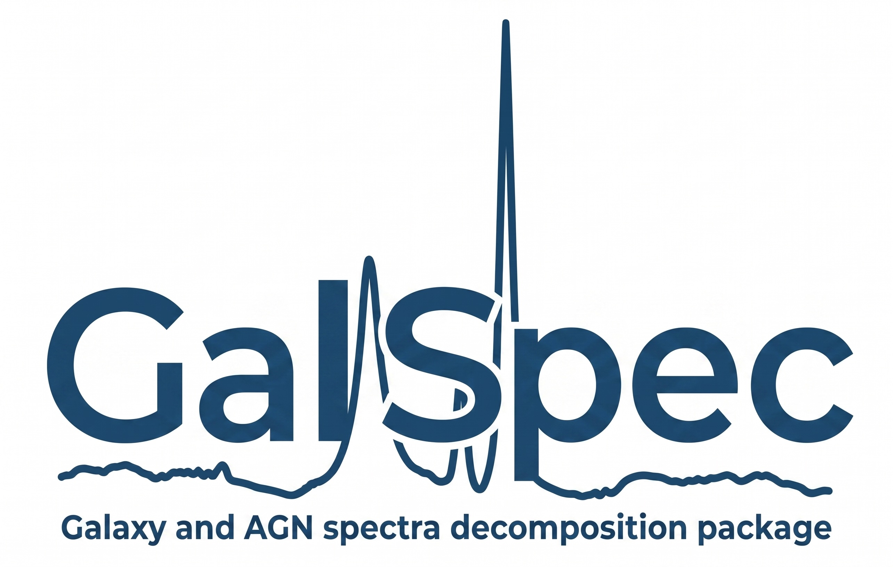

# GalSpec

Galaxy Spectrum Fitting

GalSpec is a Python package for fitting astronomical spectra, specifically designed for AGN and galaxy spectra with complex emission and absorption line features.

<p align="center">
  
</p>

## Key Features

- **Astropy Integration**: All models inherit from Astropy's modeling framework
- **Multiple Fitting Methods**: LSQ, MCMC (emcee), and nested sampling (dynesty)
- **Comprehensive Line Database**: Built-in UV/optical emission lines
- **Template Support**: Fe II and stellar population templates
- **Flexible Model Composition**: Easily combine continuum, line, and template components
- **GPU Acceleration (optional)**: JAX implementations of the same models, with
  a JNesty sampler -- 50-105x faster batched likelihood evaluations and 4-22x
  faster complete nested-sampling fits on an RTX 4090 (the larger the CPU model,
  the larger the gain; see docs/source/jax_gpu.rst)

## Documentation

Full documentation is available at: **https://jyshangguan.github.io/GalSpec/**

The documentation includes:
- Installation instructions
- Quick start tutorial with real SDSS data
- API reference for all modules
- Examples for continuum fitting, emission lines, absorption lines, and advanced techniques

## Installation

Install from source:

```bash
git clone https://github.com/jyshangguan/GalSpec.git
cd GalSpec
pip install -e .
```

### What is in the repository

`galspec/` (the package), `example/` (the worked example, its notebook and data),
`tests/`, `docs/` and `skills/`. The `develop/` tree is **not** part of this
repository: it holds the benchmarks, the mock calibrations, the [O III]
template-extraction scripts and the fits and figures they produce, and it is kept as
a standalone local git repository so that its history stays private. Paths such as
`develop/dev_jax/bench_jnesty.py`, quoted below and in the documentation, name scripts
on the author's machine rather than files you can fetch here.

## Claude Code Integration (Optional)

GalSpec includes a Claude Code skill that allows you to use GalSpec directly within Claude Code for interactive spectral fitting assistance.

To install the skill:

```bash
# From the GalSpec repository root
./install_skill.sh
```

This will:
- Create a symlink from `~/.claude/skills/galspec` to the `skills/` directory
- Enable GalSpec commands in Claude Code

To use the skill in Claude Code:
```
/skills
Use GalSpec to fit the spectrum
```

To uninstall:
```bash
rm ~/.claude/skills/galspec
```

## Quick Example

```python
import numpy as np
from astropy.modeling.models import Linear1D
from galspec import Line_Gaussian
from astropy.modeling.fitting import LevMarLSQFitter

# Load your spectrum
wave = np.linspace(6400, 6700, 1000)
flux = np.random.randn(len(wave)) * 0.1  # Your data here

# Define model: continuum + Hα line
continuum = Linear1D(slope=0.0, intercept=1.0)
halpha = Line_Gaussian(amplitude=5.0, dv=0, sigma=200, wavec=6563)
model = continuum + halpha

# Fit
fitter = LevMarLSQFitter()
fitted_model = fitter(model, wave, flux)

print(f"Hα amplitude: {fitted_model[1].amplitude.value:.3f}")
```

## GPU Acceleration (JAX)

The `galspec.jax_models` subpackage re-implements the models as pure JAX
functions, so a fit can run on a GPU. It is optional -- `import galspec` does not
require JAX.

```python
import numpy as np
import galspec
from galspec import jax_models as jxm
from galspec.jnesty_fit import JNesty_Fit

# same constructors, same fixed/tied/bounds/name semantics as the astropy models
continuum = jxm.PowerLaw1D(amplitude=0.5, x_0=5000, alpha=1.0,
                           fixed={"x_0": True}, name="Continuum")
line = jxm.Line_MultiGauss_doublet(n_components=2, amp_c0=1.7, amp_c1=0.57,
                                   dv_c=-43, sigma_c=250, wavec0=5006.84,
                                   wavec1=4958.91, name="OIII",
                                   amp_w0=0.35, dv_w0=-280, sigma_w0=340)
line.amp_c1.tied = galspec.tie_MultiGauss_doublet_ratio("OIII", 2.98)
model = continuum + line

fit = JNesty_Fit(model, wave, flux, error, nlive=200, device="auto")
fit.fit(dlogz=0.5)
best_model, names, theta = fit.get_best_fit()
print(fit.get_evidence())          # (logZ, logZ_err)
```

Install the dependencies with `pip install -e ".[gpu]"` (or `".[jax]"` for a
CPU-only JAX) and install [JNesty](https://github.com/jyshangguan/jnesty) from
its repository. See `docs/source/jax_gpu.rst` for the model list, parity
guarantees, benchmarks and the recipe for adding a new model, and
`develop/dev_jax/` for the benchmark and demo scripts.

The JAX models are verified against the CPU models by
`tests/test_jax_parity.py`; fluxes agree to ~1e-16 relative (float64), so the
GPU and CPU fits are guaranteed to be solving the same problem.

A complete worked example lives in `example/fit_iras07546_jax.py` (script,
about 8 min on one GPU) and `example/fit_iras07546_jax.ipynb` (the same fit written
out cell by cell -- the model is built literally there, seventeen constructors and
then the ties, with no wrapper functions, so a cell can be copied and changed). The
three example scripts import the same model from `example/iras07546_model.py`, and
`tests/test_example_notebook.py` fails if the notebook and that module disagree on a
single tie or prior. Each script runs on its own -- from the repository root, with
nothing but the two data files that travel with it:

```bash
python example/fit_iras07546_jax.py           # the hard ties
python example/fit_iras07546_jax_tied.py      # broad kinematics released, soft-tied
python example/fit_iras07546_jax_toggle.py    # how many broad components?
```

The example fits **4200-6800 A** of IRAS 07546+3928 (rest frame,
56 956 pixels, H-gamma to [S II]) in one go: a power-law continuum plus an Fe II
template, H-alpha/H-beta/H-gamma each modelled **twice** (a narrow `Line_template`
line and a broad `Line_MultiGauss` with a core and a wind), He I 5876 and He II 4686
with one broad Gaussian each, [O III] 4363 as a single templated line, and
[O III], [N II], [S II], [O I] as templated doublets -- 27 free parameters
describing seventeen models, with the broad components tied across the
three Balmer lines, and no least-squares step anywhere. Nothing blueward of H-gamma or redward of
[S II] is modelled, so no window has to be masked; the Na D region, which used to
be masked, is now covered by fitting He I 5876.

The narrow lines are the part that is worth reading twice, because they are not
Gaussians and they are not fitted. All ten of them are instances of **one measured
profile**, `example/data/iras07546_narrow_template.txt`: 8 001 numbers on a 1 km/s
velocity grid, extracted by `example/fit_iras07546_o3_template.py` from the
[O III] 4959/5007 doublet alone. Each narrow line then contributes one number -- its
peak -- plus one velocity shift shared by all ten, and no width at all. Where a
Gaussian model spends a shift, a width and eight peaks (14 numbers), this spends 11,
which is where the three fewer parameters come from. That extraction is a local fit in a
160 A window with a polynomial continuum, an explicit Fe II component and three
kinematic components (a core and two winds; the count was chosen by evidence in the
scan in `develop/dev_template/`, a local script, not part of this repository).

The trade is explicit and the example prints it. The frozen profile still describes
the window it was measured on -- chi2/dof 0.086 over 3 499 degrees of freedom -- so the
extraction is self-consistent; but it assumes the Balmer and forbidden narrow lines
share [O III]'s *shape*, and in this object they do not: the same local treatment
applied to H-alpha gives a width of about 300 km/s, against an equivalent `sigma` of
250 km/s for the [O III] profile. The Balmer narrow lines are about 16% broader, so a
frozen [O III] shape under-fits them, and the evidence comes out **lower** than the
Gaussian model's -- 130 677.27 +- 0.58 against 130 889.60 +- 0.62, for 27 parameters
against 30, and chi2/dof 0.315 against 0.307. That is a measurement of this object, not
a defect of the method; the extraction prints the profile's FWHM next to the template it
writes, so the assumption is checked before it is relied on.

The doublet ratios are tied at their atomic values except [S II], whose 6716/6731
ratio is a density diagnostic and is therefore measured. The Fe II template is
fitted in its `IronTemplate_tied` form: the iron is broadened by the profile of
the broad H-alpha component, tied component by component -- the core to the broad
core, the wind to the wind -- so its only free parameter is its amplitude. It
carries no weights of its own (a `Line_MultiGauss` is already a weighted sum, and
the convolution renormalises it). The core and the wind are exchangeable, so the
wind amplitude is bounded by its own core; that alone removes the mirror branch,
and the widths are left free to overlap.
`develop/dev_jax/io_test/iron_tied_io_test.html` measures the degeneracy and
shows a mock recovered with the bound in place. (`IronTemplate_new` -- one velocity dispersion
and a velocity shift -- remains available, and the two agree exactly for a
one-component kernel.) The error bar on every pixel is the measured pixel-to-pixel
scatter plus **5% of the flux** in quadrature, which stands for the photon noise
of the source.

The model is not convolved with the LSF (this spectrum grossly oversamples the
instrument); the fit is drawn with `galspec.plot.plot_fit_jax`, so every component,
the dashed sub-components of each multi-Gaussian line and the sigma-scaled residuals
appear in one figure, the marginals are drawn with
`galspec.plot.plot_posterior_hist` (axis from the posterior, not the prior), and
the whole run is written to a FITS file that
`galspec.jnesty_fit_io.load_jnesty_fit_from_fits` turns back into a working fit.
Parameter labels come from `galspec.param_labels`, so plots print
`BH$\alpha$:$\sigma_{w0}$` instead of `Halpha.sigma_w0`.

How many broad-line components the data actually need is the question of
`example/fit_iras07546_jax_toggle.py`: the three Balmer lines get a core plus
**three** wings, each wing amplitude carries a toggle prior that puts a fixed
fraction of the prior volume at exactly zero (`galspec.priors`), and one run then
returns a posterior on the number of components. It is calibrated on mocks with a known
answer by `develop/dev_jax/broad_line_components.py`, whose write-up is
`docs/source/priors.rst` (section "Worked example: switching a component off"),
together with the mock calibration. On IRAS 07546+3928 that run reports **four**
components -- a core plus three wings -- and it is not a marginal call: every one of
211 675 equally weighted samples has all three wings on and above the 3%-of-core
amplitude floor (posterior probability 1.000, against 0.84 for the Gaussian
narrow-line model of the earlier example, whose narrow-line mismatch was being paid
for out of the widest wing). It improves chi2/dof from 0.315 to 0.191, and costs
49 min at `NLIVE = 1000` for 37 free parameters.

Whether broad H-beta and H-gamma really have *the same shape* as broad H-alpha is
the question of `example/fit_iras07546_jax_tied.py`. Instead of tying their shifts
and widths to H-alpha's, each of the eight parameters gets a Gaussian prior centred
on H-alpha's value, written on the parameter itself:

```python
from galspec import priors
model.set_prior("b_hbeta.sigma_c",
                priors.Normal(mean="b_halpha.sigma_c", relative=0.20, nsigma=5))
model.set_prior("b_hbeta.dv_c",
                priors.Normal(mean="b_halpha.dv_c", sigma=0.05,
                              scale_from="b_halpha.sigma_c", nsigma=5))
```

a width is allowed to differ by 20% of H-alpha's width, a shift by 5% of it, and
`nsigma` is a hard limit -- `MAX_SIGMA = 5` at the top of the script says "nowhere
more than five widths out" (the default, seven, is where the Gaussian has run out).
The fit then reports the difference per component, in km/s and in units of that
width -- the pull -- so "similar" becomes
a measurement rather than an assumption. On this object the narrow **cores** come back
consistent with H-alpha's (pulls -0.81 and -0.46 tie widths): for them the hard tie was
right. The four **wind** parameters are where the lines differ -- H-beta's wind is
within a third of a tie width of H-alpha's, but H-gamma's is 60% broader and 504 km/s
bluer, at +2.99 of its five-width window -- and no parameter sits against a hard limit
any more, which is what the previous, Gaussian narrow-line model produced (its two wind
widths piled up on the 8000 km/s ceiling; see `docs/source/priors.rst` for that
history). The evidence is **+833 nats higher** than the hard tie's rather than the 21
lower a needless freedom would cost, and chi2/dof falls from 0.315 to 0.285: over
57 000 pixels that is +863 nats of likelihood against the 21 the extra prior volume
costs, so the gain is the better fit and not a book-keeping effect. JNesty seeds from a
fixed key, so a rerun draws the same live points; the evidence still comes back inside
its error bar rather than bitwise (three runs of the 27-parameter fit span 1.8 nats).
The control that matters is the live-point count, and rerunning the hard tie at 1000
points instead of 400 moved it by 2 nats -- two orders of magnitude inside this
difference. So the tie is too strong, and
the released parameters are measurements.
`develop/dev_jax/tied_prior_report.py` validates the mechanism on mocks whose answer
is known and writes the result up (`develop/dev_jax/io_test/tied_prior.html`;
the construction is also on `docs/source/priors.rst`, section "Worked example: a
prior centred on another parameter").

Setting a prior is not confined to these examples: every model can carry one, next
to `value`, `fixed` and `bounds`, and a prior may name another parameter as its
centre. `priors.Uniform`, `priors.LogUniform`, `priors.Normal` and
`priors.SpikeAndSlab` cover the four shapes the fits need;
`develop/dev_jax/prior_api_report.py` writes up why this is safe
(`develop/dev_jax/io_test/prior_api.html`) -- the new spelling reproduces the old
unit-cube map bit for bit on all three examples, so no published evidence moves.

## Fitting a Sample From a Configuration File

Once the model is decided, a `.toml` file can describe it together with the data
and the sampler, and `python -m galspec.pipeline` fits one spectrum or a whole
sample with it:

```toml
[data]
glob = "spectra/*.fits"
catalog_z_column = "z"

[model]
require_priors = true

[[model.component]]
type = "PowerLaw1D"
name = "Continuum"
amplitude = "3*peak_flux"
alpha = -1.0

[[model.component]]
type = "Line_Gaussian"
name = "Halpha"
wavec = "@Halpha"
amplitude = "0.5*peak_flux"
fixed = { wavec = false }

[model.component.priors.amplitude]
kind = "loguniform"
lower = "0.01*peak_flux"
upper = "5*peak_flux"
```

```bash
python -m galspec.pipeline --template config.toml  # write a commented starter
python -m galspec.pipeline sample.toml --dry-run   # check every file first
python -m galspec.pipeline sample.toml --workers 8
```

Expressions such as `"3*peak_flux"` are resolved from each source's own flux, so
one file serves a sample whose brightness differs from object to object. The
pipeline is a consumer of the models -- it builds the model a script would build
and runs the same `JNesty_Fit` -- and `import galspec` does not touch it. With
`share_compilation = true` (the default) the spectrum reaches the compiled
likelihood as an argument, so only the first source of a sample pays for the
compilation. `docs/source/config_fit.rst` has the full reference.

The worked example is the fit of `example/fit_iras07546_jax.py` written as a file:

```bash
./example/fit_iras07546_config.sh           # the published 27-parameter IRAS 07546 fit
./example/fit_iras07546_config.sh --dry-run # what would be fitted, no sampling
```

`example/fit_iras07546_config.toml` is checked against the script parameter by
parameter -- same spectrum to `1e-16`, same 17 components, same 27 free
parameters, same priors and ties, same `prior_transform` -- by
`develop/dev_config/test_iras07546_config.py`, and
`develop/dev_config/index.html` walks through it section by section. The
synthetic two-line and sample configurations live in `develop/dev_config/`.

## Example notebooks

The `example/` directory contains detailed notebooks demonstrating:
- Continuum fitting with stellar templates
- Emission line fitting for AGN
- Absorption line and BAL fitting
- Physical parameter estimation

The IRAS 07546+3928 set is one object fitted three ways, and each of the three
scripts is self-contained -- it imports `example/iras07546_model.py` and reads the
spectrum and narrow-line template from `example/data/`, so nothing has to be run
first and no script depends on another script's output files:

| file | what it decides |
|---|---|
| `fit_iras07546_jax.py` | the fiducial fit: 27 free parameters, one measured narrow profile, broad lines tied to H-alpha |
| `fit_iras07546_jax_tied.py` | whether broad H-beta and H-gamma really share H-alpha's shape (35 parameters, Gaussian priors instead of ties) |
| `fit_iras07546_jax_toggle.py` | how many broad components the spectrum needs (spike-and-slab on every wing amplitude, 37 parameters) |
| `iras07546_model.py` | the model all three fit, as an importable module |
| `fit_iras07546_jax.ipynb` | the same model written out literally, cell by cell; `tests/test_example_notebook.py` keeps the two in step |

`example/fit_sdss0006_jax.ipynb` walks through a different object and a different
question: SDSS J0006-0920 fitted the way `example/wrk_sagan_sdss0006.ipynb` fits
it -- continuum, then the [S II] doublet as a narrow-line template, then H-alpha,
then H-beta + [O III] -- but with `galspec.jax_models` and `JNesty_Fit` at every
stage instead of astropy models and `LevMarLSQFitter`. Each stage reports a
posterior instead of a point estimate, which is what makes the continuum
decomposition degeneracy visible in `sigma_*` and in
`lambda L_lambda(5100)`. About ten minutes on one GPU; repeating it moves its
numbers by well under the quoted error bars, and its H-alpha stage is checked
against `dynesty` on the astropy twin of the same model.

## Requirements

- Python ≥ 3.9
- numpy, scipy, matplotlib, astropy, pandas
- emcee, dynesty (for Bayesian fitting)
- jax + jnesty (optional, for GPU-accelerated fitting)

**Note**: When using `ReadSpectrum` class for extinction correction, SFD dust map data (4 FITS files, ~167MB total) will be automatically downloaded from [kbarbary/sfddata](https://github.com/kbarbary/sfddata) on first use.

## License

MIT License - see LICENSE file for details

## Links

- **Documentation**: https://jyshangguan.github.io/GalSpec/
- **GitHub Repository**: https://github.com/jyshangguan/GalSpec
- **Issue Tracker**: https://github.com/jyshangguan/GalSpec/issues
