Example: measure the black hole and the host galaxy
====================================================

The other example fits a luminous AGN, where the continuum is a power law and the lines sit on
top of it. This one goes the hard direction: a low-redshift SDSS spectrum in which the starlight
is *most* of the light between 3900 and 7000 A, so the continuum has to be taken apart into
five stellar populations and a nucleus before anything else can be measured. Two numbers come
out of that decomposition -- the stellar velocity dispersion and the 5100 A luminosity -- and
they, with the width of broad H-beta, give the black-hole mass.

Every code block on this page is a cell of ``example/fit_sdss0006_jax.ipynb``, the notebook of
the same name, so a block can be copied into a notebook and run:

* ``example/fit_sdss0006_jax.ipynb`` -- the whole analysis, cell by cell: four nested-sampling
  stages, the posterior of each, and the twelve figures below;
* ``example/data/spec-0651-52141-0434.fits`` -- the spectrum (SDSS plate 0651, MJD 52141, fibre
  0434: 3 841 pixels from 3 806 to 9 215 A, with an inverse variance per pixel);
* ``example/output/sdss0006_sii_template.txt`` -- the narrow-line profile, written out at
  step 4 so that a reader who finds only the file knows where it came from.

SDSS J000605.59-092007.0, z = 0.0699. The object has broad H-alpha (FWHM ~ 2 900 km/s), narrow
[O III]/H-beta ~ 5 and [N II]/H-alpha ~ 0.7 -- a Seyfert 1 whose host is comparable to the
nucleus at these wavelengths, which is what makes it the interesting case. The whole page runs
in about ten minutes on one GPU.

.. contents:: On this page
   :local:
   :depth: 2

The answer, first
-----------------

Four stages, each sampled separately, each with its own evidence::

     stage 1   log Z = -2047.05 +- 0.12   the continuum: 5 stars + a power law, 9 free
     stage 2   log Z =     -94.58 +- 0.08   [S II]: the narrow-line template, 7 free
     stage 3   log Z =    -454.60 +- 0.11   the H-alpha complex, 8 free
     stage 4   log Z =   -1070.14 +- 0.14   + H-beta and [O III], two windows, 14 free

and what they give::

     sigma_*                   74.20 (-5.27/+5.56) km/s      <- stage 1
     lambda L_lambda(5100)     2.27 (-0.28/+0.24) e42 erg/s  <- stage 1
     FWHM(broad H-alpha)       2946 (-254/+300) km/s         <- stage 3
     FWHM(broad H-beta)        3430 (-624/+716) km/s         <- stage 4
     log [N II]/H-alpha        -0.133 (-0.152, -0.112)       <- stage 3
     log [O III]/H-beta        +0.682 (+0.624, +0.745)       <- stage 4
     log M_BH [M_sun]          7.10 (-0.17/+0.17)            <- stages 1 + 4

Read ``sigma_*`` with the caveat in section 5: it is the number in this list that a second run
of the same stage does not reproduce, and the interval above is narrower than the run-to-run
spread.

1. The spectrum
---------------

Everything the notebook needs is set in one cell: the file, the redshift, the foreground
extinction, the sampler's two numbers and the device. The two sampler numbers are 2 000 live
points and a 2% evidence tolerance, which is what every run quoted on this page used; ``QUICK =
True`` drops them to 300 and 10% and fits the whole page in a minute, for checking that
something runs rather than for a number.

.. nbcode:: ../../example/fit_sdss0006_jax.ipynb
   :cell: settings

The data arrive the way SDSS delivers them: a ``flux`` column, a ``loglam`` column and an
``ivar`` column, in 10^-17 erg/s/cm^2/A. The error is not estimated, it is given -- which makes
this an easier start than :doc:`example_strong_agn`, where the spectrum came without one and the
error had to be measured off the scatter.

Two transformations take it to the frame the model lives in: the Milky Way reddening is removed
(``A_V = 0.105`` from NED, the CCM89 law applied on the observed grid) and the wavelength is
divided by ``1 + z``. Both happen in one cell, and the resulting arrays are what every stage
below fits.

.. nbcode:: ../../example/fit_sdss0006_jax.ipynb
   :cell: data

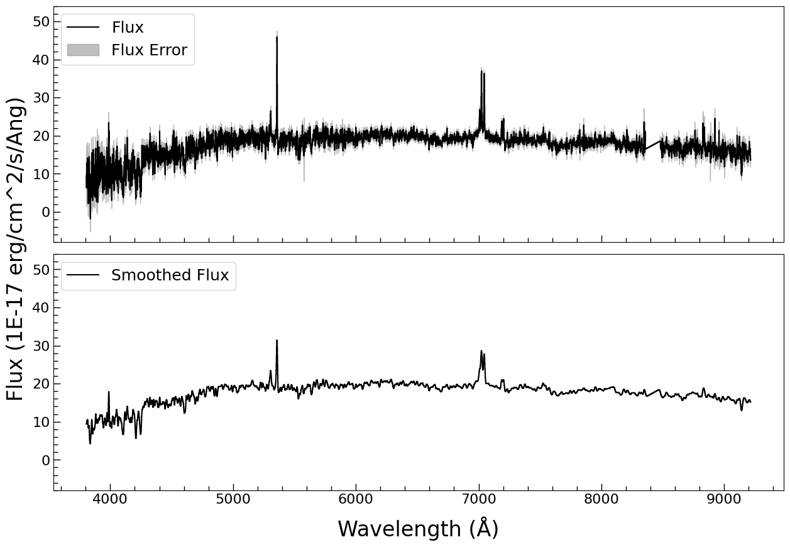

   The spectrum as it arrives, and the same 3-pixel-smoothed. The 4 000 A break is the host
   galaxy, the two spikes are H-alpha and [O III] 5007: at this redshift the galaxy's 4000 A
   break and the AGN's lines are both inside one SDSS window.

.. nbcode:: ../../example/fit_sdss0006_jax.ipynb
   :cell: deredden

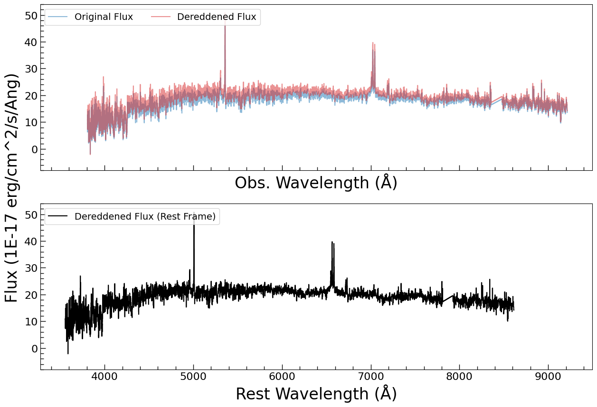

   Top: the observed flux and the same flux with the foreground reddening removed -- the
   correction is a slope, so it lifts the blue end by about 10%. Bottom: the same flux in the
   rest frame, 3 560-8 610 A -- the model is fitted in that frame, so this is the spectrum every
   stage below sees. The gap at 7 600 A is the dichroic edge, and no window crosses it.

2. The continuum windows
------------------------

The starlight is fitted only where there are no emission lines, because an emission line in the
continuum fit would be absorbed by a stellar template's absorption feature and then subtracted
from the data before the lines are measured. The six windows are the ones Greene & Ho (2005)
use for this purpose: 3 900-4 060 (which includes Ca II H and K, the sharpest features in the
whole spectrum), 4 170-4 260, 4 430-4 770, 5 080-5 550, 6 050-6 200 and 6 890-7 010 A. That is
1 153 of the 3 841 pixels -- 30%; the other 70% enter the likelihood with zero weight, through a
boolean mask rather than by truncating the arrays.

.. nbcode:: ../../example/fit_sdss0006_jax.ipynb
   :cell: cont_windows

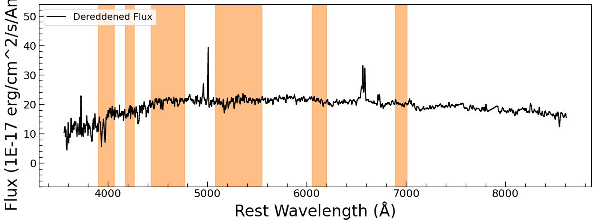

   The dereddened rest-frame spectrum with the six continuum windows shaded. Note what is
   *outside* them: H-beta and [O III] 4959/5007, the Mg I b triplet region around 5 170 (inside
   the fourth window, and a reason it is 470 A wide), H-alpha with [N II] and [S II], and the
   [S II] 6716/6731 pair.

3. The continuum model
----------------------

Five stellar templates and a power law. The templates are ``StarSpectrum`` objects -- a
population's spectrum resampled onto a velocity grid and broadened by the galaxy's velocity
dispersion -- one per spectral type, A through M, and each carries a free amplitude because the
mix of populations is what the data are supposed to decide, not an assumption. One width and
one velocity shift are shared by all five: a single galaxy has one ``sigma_*``, and its stars
cannot move relative to each other.

.. nbcode:: ../../example/fit_sdss0006_jax.ipynb
   :cell: model_continuum

Nine free parameters, and they are worth naming: five star amplitudes, one velocity dispersion,
one redshift offset, the power law's amplitude and its slope. The iron pseudo-continuum is left
out, and that is a measurement rather than an omission -- this object's spectrum shows no
significant Fe II structure, so a template for it would fit noise.

The priors are the part that makes this reproducible on another object, because every one is
scaled from the spectrum in the cell that sets it: a star amplitude or a power-law amplitude is
a ``LogUniform`` from 10^-2 to three times the brightest continuum pixel, the velocity
dispersion a ``Uniform`` from the velocity scale of the templates (20 km/s) to 300 km/s
(following Kong & Ho 2018), the redshift offset a ``Uniform`` of +-0.001, and the slope a
``Uniform`` of +-2 in ``F_lambda``, which covers every optical AGN slope anyone has measured.

.. nbcode:: ../../example/fit_sdss0006_jax.ipynb
   :cell: priors_continuum

The fit returns the posterior, not a minimum, and the cell prints it as median with 16th and
84th percentiles::

     A Star.amplitude          0.16686      0.11      0.25
     F Star.amplitude           9.0816      0.68      0.72
     G Star.amplitude           10.092      0.67      0.58
     K Star.amplitude           1.2311      0.53      0.68
     K Star.sigma               74.202       5.3       5.6
     K Star.delta_z         -0.00033186     2e-05     2e-05
     M Star.amplitude           3.3809      0.63      0.58
     PowerLaw.amplitude         3.5424      0.42      0.36
     PowerLaw.alpha           -0.70001      0.38      0.28

.. nbcode:: ../../example/fit_sdss0006_jax.ipynb
   :cell: fit_continuum

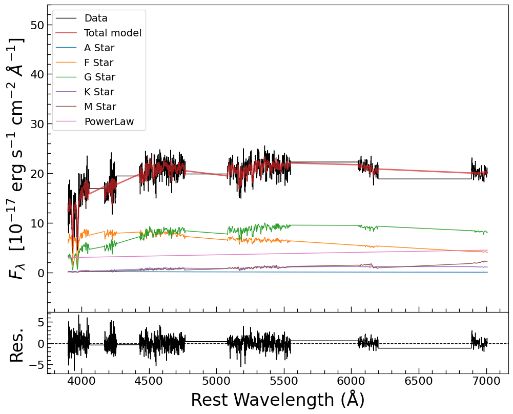

   The continuum fit: the six windows, the data, the total model, and the five templates plus
   the power law underneath it. The lower panel is the residual in units of the error. At 3.2
   minutes this is the longest of the four stages -- they sum to six -- because it is the only
   one with a strongly degenerate parameter space.

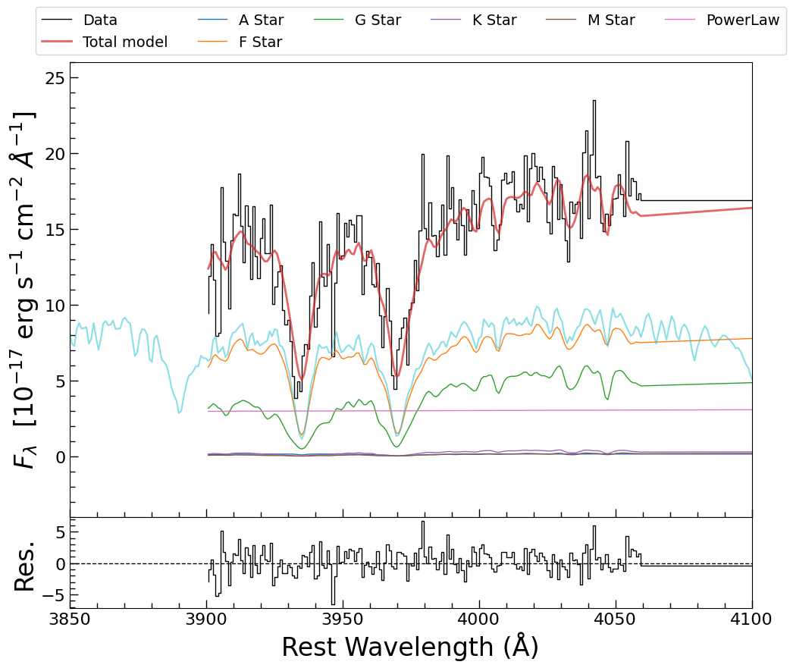

   Ca II H and K, zoomed. These are the features that measure ``sigma_*``. At 3 950 A the SDSS
   line-spread function is 2.4 A in FWHM, a sigma of 77 km/s: the instrument is as wide as the
   dispersion being measured, so the fit reads a line that is barely broader than the
   instrumental profile -- which is why the width below is the fragile number.

4. sigma_* and the 5100 A luminosity
------------------------------------

Two numbers are taken out of the continuum stage. The first is the posterior of ``K Star.sigma``
-- the shared velocity dispersion, so any of the five stars would give it. The second is the
luminosity at 5100 A, and it is not read off the power law's amplitude: amplitude and slope are
correlated, so the level at 5100 A is computed *per sample*, ``amp * (5100/5000)**alpha``, and
the median of that distribution is quoted with its own percentiles. Taking the median of each
parameter and multiplying afterwards would not give the same number.

.. nbcode:: ../../example/fit_sdss0006_jax.ipynb
   :cell: flux_lines

::

     The velocity dispersion (sigma) is 74.20 (-5.27/+5.56) km/s
     The 5100 A continuum luminosity is 2.27e+42 (-2.83e+41/+2.38e+41) erg/s

5. What the continuum posterior is, and is not
----------------------------------------------

The two numbers above do not have the same quality, and the difference is a property of the
model rather than of the sampler.

The 5100 A luminosity is robust. Every decomposition in the family of fits carries the same
flux at 5100 A -- the fit happens 100 A away -- so repeated runs give 1.9 to 2.3 x 10^42 erg/s
where the interval from one run is +-0.25.

The velocity dispersion is not. The continuum is nine parameters describing one smooth curve,
and the split between the five stellar templates and the power law is a direction the data
weakly constrain: run the *same* stage with the same priors and a different sampler bounding
(``bound='multi'`` against ``bound='single'``) and the evidences agree to 1.3 nats while
``sigma_*`` comes out 74.2 and 86.3 km/s -- intervals that do not overlap. Both runs are
converged approximations of one posterior that neither of them fully mapped. Two consequences,
both used below:

* the 68% interval from one run (+-5 km/s) is *narrower than the run-to-run spread*, so
  ``sigma_*`` = 74 +- 10 km/s is the error to carry into the M-sigma panel;
* the decomposition itself -- which star is bright, what the slope is -- is not a measurement.
  The K star's amplitude is 1.2 in this run and was 4.3 in the least-squares fit of the same
  windows, and the power-law slope is -0.70 here against -0.26 there: the two fits trade
  starlight for power law and still land on the same flux at 5100 A.

That is worth internalising before using any staged continuum decomposition: a least-squares
fit would have returned one of those decompositions as *the* answer, with an error bar from the
covariance matrix that is just as optimistic.

6. The narrow-line template, measured on [S II]
-----------------------------------------------

Every narrow line in the rest of the analysis is one measured profile with an amplitude each,
rather than a Gaussian with a width each. The profile is measured here, on [S II] 6716/6731:
the two peaks give two samplings of the same shape, and apart from one unmodelled spike at
6 762 A the 100 A window is clean.

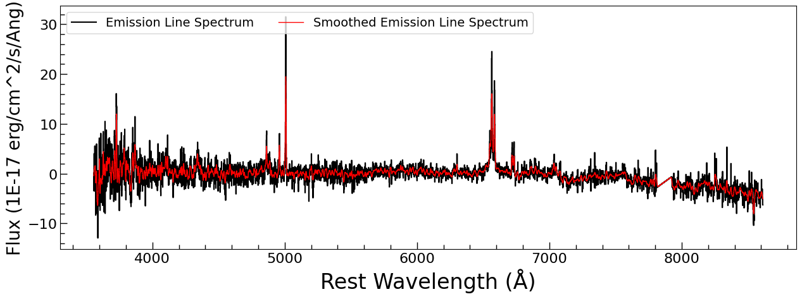

   The spectrum with the best-fit continuum subtracted -- what stages 2 to 4 have to explain.
   H-beta and [O III], H-alpha with [N II] and [S II], the [O I] pair at 6 300/6 364, and little
   else: the red end is clean, which is why [S II] can be measured on its own first.

The model is a ``Line_MultiGauss_doublet`` with one core and one wind per peak -- the wind is
the broad base that a Gaussian cannot bend into, and it is what makes the profile worth
measuring rather than assuming. Seven free parameters: two amplitudes, one shared width, one
shared shift, and the wind's three (relative amplitude, shift, width).

.. nbcode:: ../../example/fit_sdss0006_jax.ipynb
   :cell: model_sii

.. nbcode:: ../../example/fit_sdss0006_jax.ipynb
   :cell: priors_sii

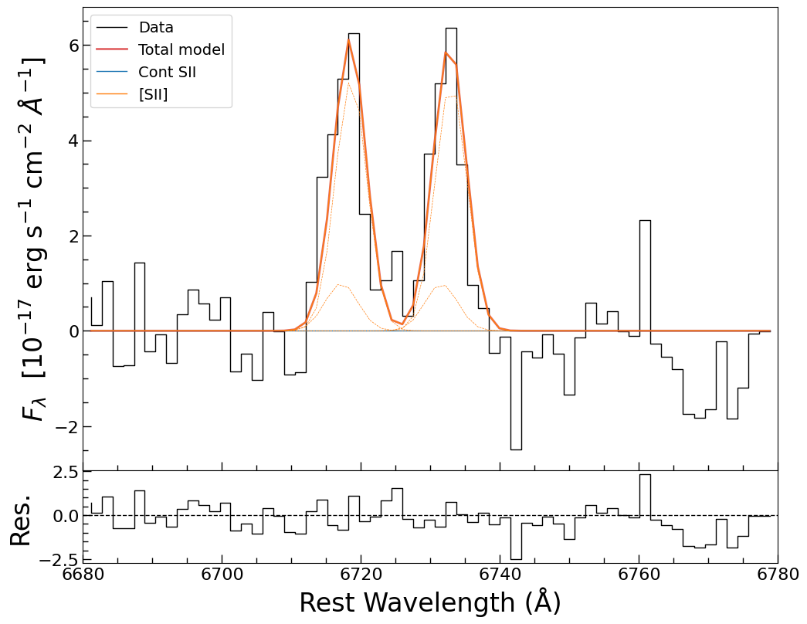

   The [S II] fit, ``log Z = -94.58 +- 0.08`` in 0.5 minutes. The solid curves are the two
   peaks, the dotted ones the winds. The spike at 6 762 A is real in the data and absent from
   the model: it is 1 500 km/s from 6731, outside both profiles, so the ratio of the two peaks
   is unaffected -- at the price of a handful of large residuals.

The template is then read off the model -- ``gen_template`` returns the *single-line* profile on
a velocity grid, centred and normalised -- and written out with its provenance. It is this file,
not the model, that the next two stages use, and that is what makes the four stages independent.

.. nbcode:: ../../example/fit_sdss0006_jax.ipynb
   :cell: template

::

     template: 1200 velocity bins, peak 1.000, FWHM 240 km/s

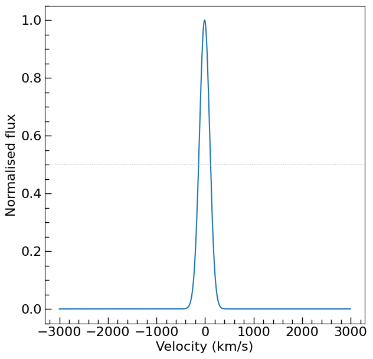

   The measured profile: FWHM 240 km/s, with the wings the wind accounts for. The reference
   least-squares fit of the same spectrum gives 245 km/s.

7. The H-alpha complex
----------------------

The continuum-subtracted spectrum is now fitted in the H-alpha window with four components:
broad H-alpha (a Gaussian -- the broad-line region does not share the narrow kinematics),
narrow H-alpha (the template), and the two narrow doublets [N II] 6548/6583 and [S II]
6716/6731. The doublets are single ``Line_template_doublet`` components rather than two
templates tied together, so the pair cannot drift apart, and the [N II] ratio is tied to its
atomic 2.96 while the [S II] ratio is left free -- 6716/6731 is the density diagnostic, and this
fit measures 1.04, which is the low-density end.

.. nbcode:: ../../example/fit_sdss0006_jax.ipynb
   :cell: model_ha

.. nbcode:: ../../example/fit_sdss0006_jax.ipynb
   :cell: priors_ha

Eight free parameters, and the prior cell is where the model's assumptions become visible: the
broad line's width is allowed to reach 6 000 km/s while its shift is confined to +-1 000 km/s
around the systemic velocity; every amplitude is ``LogUniform(0.1, 3 * peak)``, i.e. from a
tenth of the flux unit to three times the window's peak; and the systemic shift is +-500 km/s,
which is wide enough to hold any rotation the template does not know about.

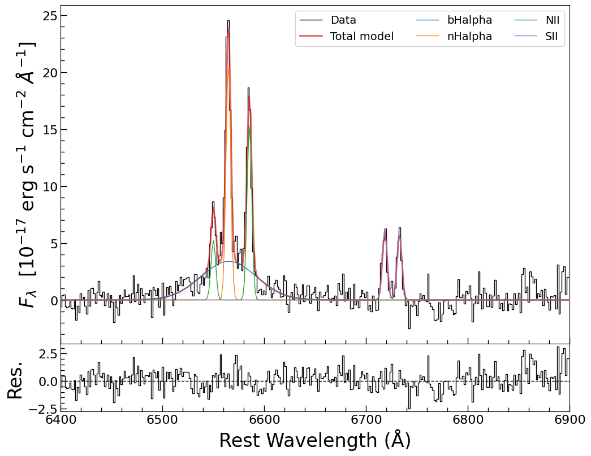

   The H-alpha window, ``log Z = -454.60 +- 0.11`` in 0.9 minutes. Broad H-alpha under the two
   [N II] lines, and the [S II] pair on the right, each doublet drawn as one curve.

::

     bHalpha.amp_c               3.3818      0.27      0.29
     bHalpha.dv_c               96.659        78        76
     bHalpha.sigma_c            1247.9   1.1e+02   1.2e+02
     nHalpha.amplitude          21.146      0.73      0.73
     nHalpha.dv                 94.851       2.8       2.8
     NII.amp_c0                 15.526      0.62      0.63
     SII.amp_c0                 6.0437      0.53      0.54
     SII.amp_c1                 5.8324      0.53      0.54

The narrow H-alpha shift of 94.9 +- 2.8 km/s is the systemic velocity, and it is the one ``dv``
that every other narrow line inherits from here on -- H-beta, [O III] and the [O III] wing are
all tied to it, which is what "the narrow-line region moves as one body" means in a model.

8. H-beta and [O III]
---------------------

The second window pair -- 4 700-5 100 and 6 400-6 900 A -- brings H-beta, the [O III] doublet
and a broad wing under [O III] 5007. The fit is now over both windows at once with the H-alpha
complex carried along unchanged, so the narrow lines keep one velocity across a 1 700 A
baseline. H-beta shares broad H-alpha's shift but not its width: the width is a measurement, and
it is the one that goes into the black-hole mass.

.. nbcode:: ../../example/fit_sdss0006_jax.ipynb
   :cell: model_hb

.. nbcode:: ../../example/fit_sdss0006_jax.ipynb
   :cell: priors_hb

Two priors deserve a note. The broad [O III] wing's amplitude is bounded to *half* the window's
peak, because the wing sits at the same wavelength as the [O III] template: leave it free to
reach the line's strength and the sampler finds the decomposition in which the "wing" *is* the
line -- amplitude 30 where 0.4 belongs, a starved narrow line under it, and an [O III] flux two
orders of magnitude low. Bounding the wing is a prior choice, not a measurement, and it is the
one choice on this page that changes a number if it is made differently. The wing's width runs
up to 2 000 km/s for the opposite reason: a wing is not a line core, and nothing in the data
says how far its tail goes.

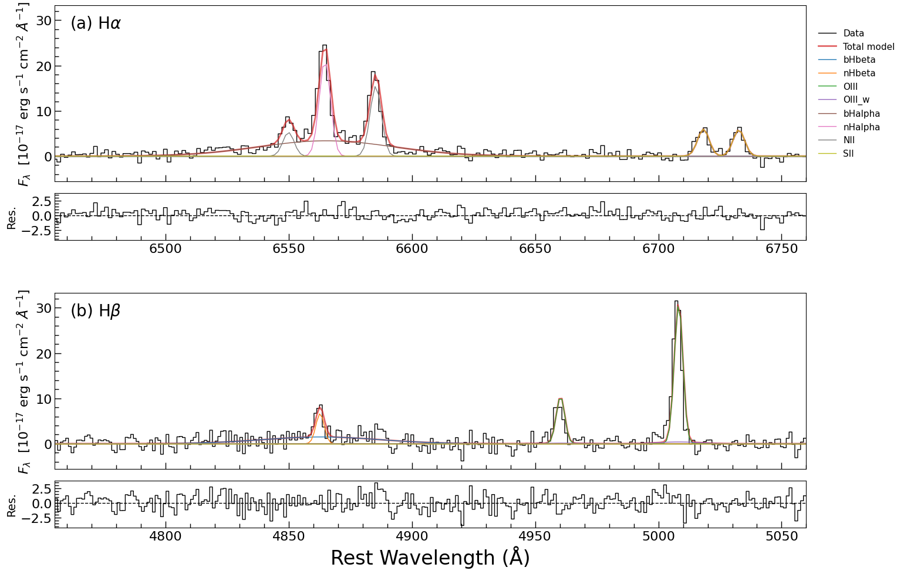

   Both windows from the final stage, ``log Z = -1070.14 +- 0.14`` in 1.5 minutes: (a) the
   H-alpha complex, (b) H-beta, [O III] 4959/5007 and the broad base under 5007. The [O III]
   pair is one doublet with the atomic 2.98 ratio imposed; the lowest panel is the residual.

::

     bHbeta.amp_c               1.4843      0.27      0.28
     bHbeta.sigma_c             1457.8   2.5e+02     3e+02
     nHbeta.amplitude           6.6369      0.86      0.86
     OIII.amp_c0                30.838       1.2         1
     OIII_w.amp_c0             0.37986      0.22      0.66
     OIII_w.sigma_c              508.4   2.5e+02   6.1e+02

The [O III] wing is detected but not measured: an amplitude of 0.38 (-0.22/+0.66) and a width of
510 (-250/+610) km/s say that something broad is under 5007 and that neither its strength nor
its shape is pinned down. Do not read a velocity off it.

9. The fluxes and the widths
----------------------------

Line fluxes are combinations of parameters, so they are computed per posterior sample rather
than from the medians -- that is how the error bar inherits the correlations in the fit -- and
for a doublet, one line at a time: ``Line_template_doublet.single(wave, comp)`` gives the
profile of one line of a pair, which is what [N II] 6583, [O III] 5007 and each [S II] line
need. Integrating a doublet whole would fold 6548 into the [N II] flux.

.. nbcode:: ../../example/fit_sdss0006_jax.ipynb
   :cell: physical_parameters

::

     F(H-beta) broad           8.772e-16  -1.48e-16/+1.54e-16
     F(H-alpha) broad          2.315e-15  -1.28e-16/+1.39e-16
     F(H-beta) narrow          2.821e-16  -3.76e-17/+3.58e-17
     F(H-alpha) narrow         1.215e-15  -4.11e-17/+4.19e-17
     F([O III] 5007)           1.354e-15  -5.52e-17/+4.6e-17
     F([N II] 6583)            8.951e-16  -3.46e-17/+3.6e-17
     F([S II] 6716+6731)       6.951e-16  -4.71e-17/+4.53e-17
     FWHM(H-alpha) broad            2946  -254/+300
     FWHM(H-beta) broad             3430  -624/+716
     FWHM([O III]) [km/s]            244  (the template's shape: no width is fitted)

The broad and the narrow Balmer fluxes are kept apart on purpose, and the reason is in the two
numbers below: the narrow lines give H-alpha/H-beta = 4.3, which is what a reddened narrow-line
region looks like (case B is 2.86, and 4.3 is E(B-V) ~ 0.4 on the Galactic extinction curve),
while the broad lines give 2.6, i.e. case B within the errors -- the broad-line region is behind
less dust. (The foreground reddening was removed at the start of the page; this is dust in the
galaxy.) Adding the two components together would produce one meaningless average.

10. The BPT diagram
-------------------

Two ratios of forbidden to recombination lines, both measured off the model: [N II] 6583 over
H-alpha and [O III] 5007 over H-beta. The forbidden lines come from the narrow-line region
only, so the Balmer denominator is the *narrow* component too; putting the broad lines in the
denominator dilutes both ratios and moves a Seyfert 1 towards the star-forming corner. (This is
where this notebook departs from the reference it follows: the reference divides by the broad
Balmer flux, and its version of this figure puts the object between the demarcation lines, in
the "composite" region.)

.. nbcode:: ../../example/fit_sdss0006_jax.ipynb
   :cell: bpt

::

     log([N II] 6583 / H-alpha, narrow) = -0.133  (-0.152, -0.112)
     log([O III] 5007 / H-beta, narrow) = +0.682  (+0.624, +0.745)
     log([S II] 6716+6731 / H-alpha)    = -0.242  (-0.276, -0.212)
     the demarcations at this x: Kewley+2001 +0.18,  Kauffmann+2003 -2.03

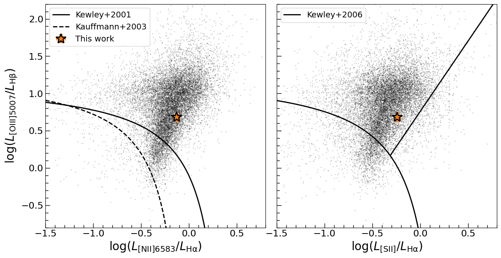

   The object against the Liu et al. (2019) AGN sample, on both BPT planes. It sits with the
   AGN: well above the Kewley et al. (2001) line in the [N II] plane, and on the Seyfert side of
   the Kewley et al. (2006) line that separates Seyferts from LINERs in the [S II] plane --
   which is what a 2 900 km/s broad H-alpha and [O III]/H-beta ~ 5 say it should.

The background points come from ``Liu2019.fits``, which is not in the repository: it is public
data (Liu et al. 2019, ApJS 243, 21) and the notebook expects it in ``develop/temp/``. Only the
background *points* need it; the fit does not.

11. The black hole and the host galaxy
--------------------------------------

The black-hole mass pairs the two stages, using Liu et al. (2019) Equation 2::

     log M_BH = 0.533 log(L_5100 / 1e44) + 2 log(FWHM_Hbeta / 1000) + 6.91

The two posteriors are independent fits, so the two numbers are drawn at random from them and
paired; the quoted error is the width that comes out, which now carries both stages. It is not
the same as a joint fit's error -- no correlation between the continuum and the line widths can
be seen this way -- but it is the honest version of what the staged procedure measures.

.. nbcode:: ../../example/fit_sdss0006_jax.ipynb
   :cell: mbh_sigma

::

     sigma_* = 74.2 (-5.3/+5.6) km/s
     log M_BH = 7.10 (-0.17/+0.17)

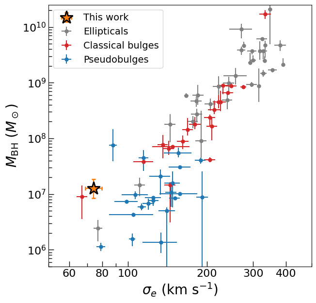

   The object on the M-sigma plane, against the Kormendy & Ho (2013) sample. At ``sigma_*`` =
   74 km/s their relation gives 10^6.8 solar masses; the fit gives 10^7.1, about 0.3 dex above
   it and inside both its scatter and our own +-0.17 dex. The horizontal error bar is the
   +-10 km/s of section 5, not the +-5 of the single run.

12. What the numbers say against the reference fit
--------------------------------------------------

The notebook follows ``example/wrk_sagan_sdss0006.ipynb`` -- the same windows, the same
components, the same atoms -- but fits with nested sampling instead of
``LevMarLSQFitter``, so every number comes with a posterior. The comparison is the honest test
of the translation:

===================  ==================  =====================
quantity             reference (LSQ)     this page
===================  ==================  =====================
sigma_*              79.62 km/s          74.20 (-5.3/+5.6)
lambda L_5100        2.17e42 erg/s       2.27 (-0.28/+0.24)
[S II] template      245 km/s            240 km/s
bHalpha.sigma_c      1102 km/s           1248 (-110/+120)
bHbeta.sigma_c       1240 km/s           1458 (-250/+300)
nHalpha.amplitude    21.09               21.15 (-0.73/+0.73)
[O III] 5007         28.66               30.84 (-1.2/+1.0)
log M_BH             6.95                7.10 (-0.17/+0.17)
===================  ==================  =====================

Every quantity agrees to within two sigma of the intervals above (the largest gap is [O III]
5007, 1.8 sigma), which is what should happen when the same model is fitted to the same pixels.
The differences are largest where the reference's widths are: broad H-beta is 1 458 here against
1 240, and since the mass goes as its square that is most of the 0.15 dex in ``log M_BH``. That
is a real disagreement about the profile's shape -- a least-squares fit pulls the broad H-beta
width down towards the narrow feature it overlaps, and it is the sort of thing a posterior makes
visible instead of hiding. (The reference notebook prints no mass; its 6.95 is the same equation
applied to its own sigma and luminosity.)

13. What to check before believing any of it
--------------------------------------------

**The sampler, first.** JNesty defaults to a queue-mode sampler when ``bound='multi'``, and on
these models that path is not reproducible: repeated runs of the H-alpha stage landed on
evidences between -478 and -456 with broad-line widths 40% apart, depending only on how much GPU
memory was free when the run started. The notebook sets ``queue_size=0`` (JNesty's legacy batch
mode), under which the same stage reproduces to half a nat and lands where ``dynesty`` lands
when the same model is written with the astropy classes and sampled on the CPU:

=================  =============  =================================
sampler            log Z          sigma(bHalpha)
=================  =============  =================================
JNesty, queue off  -460.9         1346 km/s
JNesty, queue off  -461.4         1346 km/s
dynesty (CPU)      -461.8 +- 0.2  1350 (+1212, +1497)
=================  =============  =================================

**``nlive``, second.** 400 live points under-sample the broad-line amplitude-width ridge and the
evidence moves by several nats between runs even with the queue off; 2 000 is where the stages
above were sampled.

**The stages are separate.** Each stage samples its own posterior and the next one reads the
previous one's *median*, not its posterior: the continuum is subtracted at its medians before
the [S II] window is fitted, and the [S II] template is frozen when H-alpha is. A joint fit over
the whole spectrum would carry every correlation; this is the staged procedure the reference
notebook uses, done with posteriors.

**The template has the instrumental resolution in it.** The [S II] profile includes the SDSS
line-spread function, 2.4 A in FWHM -- 107 km/s at 6 700 A -- so the widths above are observed,
not corrected. If the gas kinematics matter, subtract it in quadrature; the reference notebook
does not, and neither does this one.

14. Saving the fit, and where to go next
----------------------------------------

The last stage is written to a FITS file that ``load_jnesty_fit_from_fits`` reads back into a
``JNesty_Fit``: the samples and their weights, the evidence, the parameters, prior bounds and
ties, the model description and the spectrum. Everything after the sampler in this page can then
be redone without resampling.

.. nbcode:: ../../example/fit_sdss0006_jax.ipynb
   :cell: save

* :doc:`example_strong_agn` -- the same machinery on a luminous AGN, where the continuum is a
  power law and the hard part is the narrow-line profile instead.
* :doc:`priors` -- the prior shapes used above, and how to make one parameter's prior depend on
  another's.
* :doc:`jax_gpu` -- the JAX backend, the batching, and the CPU-versus-GPU comparison.
* :doc:`config_fit` -- the same model and sampler driven from a TOML file, for a whole sample.