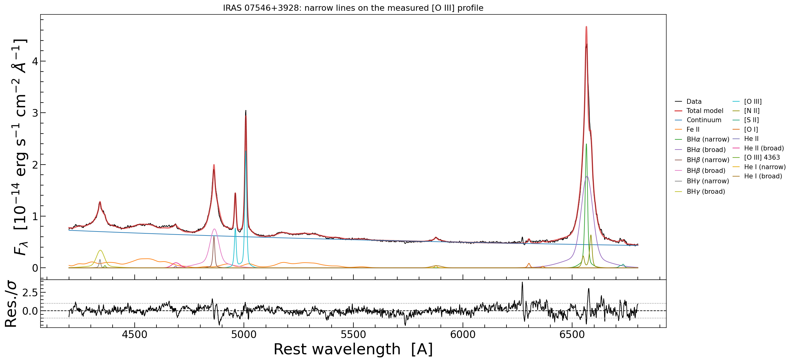
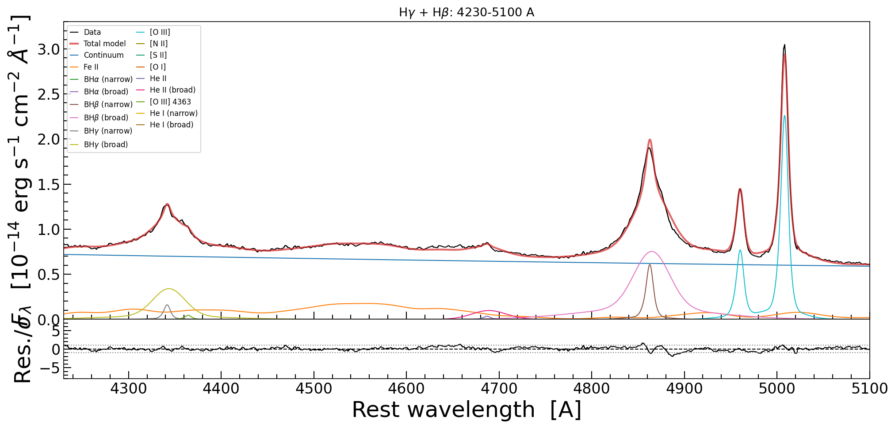
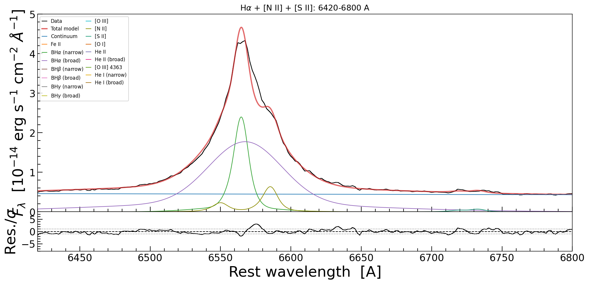
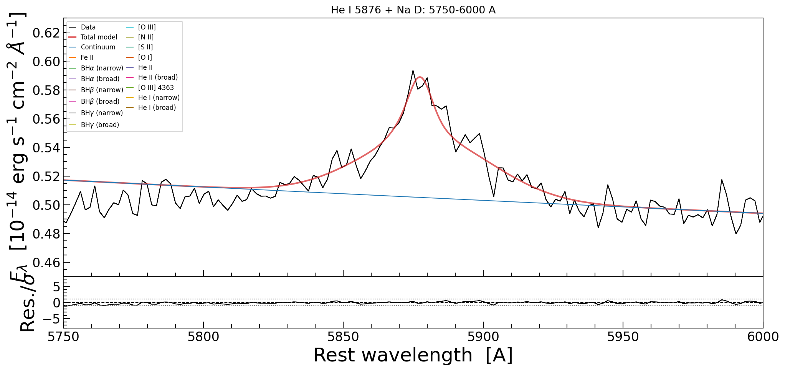
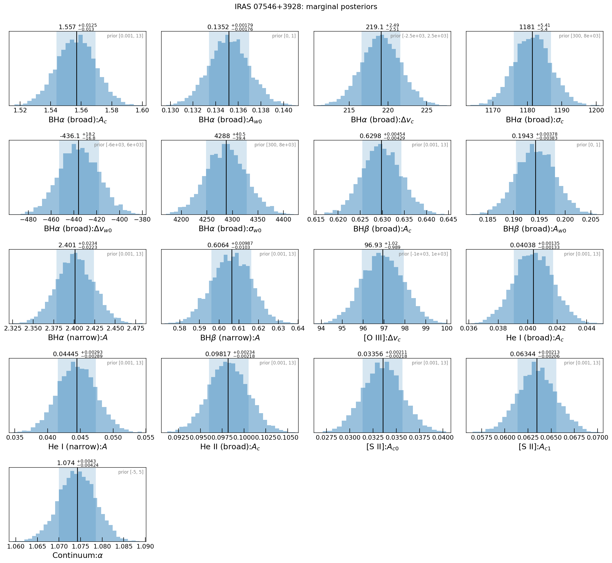
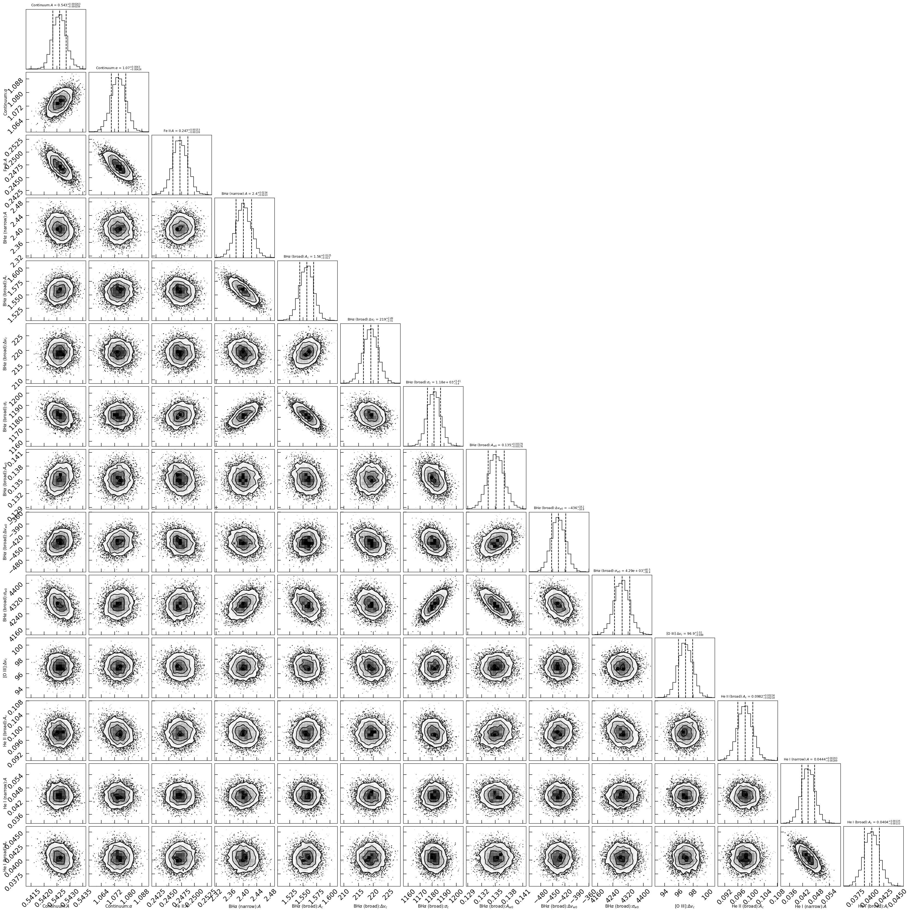

A realistic fit, start to finish
================================

One AGN spectrum, one model, one sampler, four steps. This page is the whole fit as
the script runs it -- ``example/fit_iras07546_jax.py``, of which every code block below
is a verbatim slice -- together with the products that run writes (the figures are
copies of the files in ``example/output/``). The same story is in
``example/fit_iras07546_jax.ipynb`` if you would rather execute it cell by cell.

IRAS 07546+3928 at z = 0.0953: 4200-6800 A in the rest frame, 57 000 pixels at 0.046 A
sampling, H-gamma through H-alpha with the strong forbidden lines, fitted in one go
with 27 free parameters. Full settings on one GPU: 400 live points, ``dlogz = 0.01``.

Twelve of those 27 are narrow-line parameters -- eleven peaks and one shared shift; the
narrow *profile* is not fitted at all. It is one measured object, ``example/data/iras07546_narrow_template.txt``,
extracted from the [O III] doublet by ``develop/dev_template/stage1_o3_template.py``
and shared by every narrow line, which is what makes the parameter count 27 instead
of 30. Step 2 below reads it from that file and says why.

.. contents:: On this page
   :local:
   :depth: 1

1. Read the spectrum
--------------------

The data come from a FITS file, are dereddened, shifted to the rest frame and cropped;
the error array is re-derived from the scatter of the spectrum itself rather than
trusted from the header. That last step matters: a wrong error scale makes every
posterior too narrow or too wide by the same factor.

.. literalinclude:: ../../example/iras07546_model.py
   :language: python
   :start-after: # %% load
   :end-before: # %% helpers

2. Build the model, and give every parameter a prior
----------------------------------------------------

The model is a compound astropy model: a power-law continuum, the iron template, and
one submodel per line. It is built by ``build_model`` and ``set_priors``, which live in
``example/iras07546_model.py`` so that this example, ``fit_iras07546_jax_tied.py`` and
``fit_iras07546_jax_toggle.py`` all fit the same thing instead of three copies of it.
The step in the script is two calls, after the profile is read and reported:

.. literalinclude:: ../../example/fit_iras07546_jax.py
   :language: python
   :start-after: # %% step-2-model
   :end-before: # %% step-3-fitter
   :dedent: 4

and the construction itself is the next two blocks, from that module. Seventeen
components, in the order they are summed:

.. literalinclude:: ../../example/iras07546_model.py
   :language: python
   :start-after: # %% model
   :end-before: # %% priors

``set_priors`` attaches one prior per free parameter, in four groups: continuum and
iron, every line peak (log-uniform), narrow kinematics (one shift shared by every
narrow line, measured from [O III] -- there is no narrow width to give a prior to,
because the profile in the template carries it), and broad kinematics (one width box
of 300-8000 km/s for the core *and* the wind, with each Balmer line keeping its own
amplitude). The recipe is written out on :doc:`priors`, which also explains what each
shape does and how to make one parameter's prior depend on another's.

A fit with an unset prior is a silent bug: the parameter then samples its whole default
box. The check above turns that into an error before the sampler starts.

3. Run the sampler
------------------

Nested sampling on the GPU. ``nlive`` live points are kept, and the run stops when less
than ``dlogz`` of the evidence may remain unseen.

.. literalinclude:: ../../example/fit_iras07546_jax.py
   :language: python
   :start-after: # %% step-3-fitter
   :end-before: # %% step-4-fit
   :dedent: 4

.. literalinclude:: ../../example/fit_iras07546_jax.py
   :language: python
   :start-after: # %% step-4-fit
   :end-before: # %% step-5-results
   :dedent: 4

The run prints its own summary::

      template: iras07546_narrow_template.txt, 8001 points, -4000 to +4000 km/s, FWHM 591 km/s

      model: 17 components, no LSF convolution, 27 free parameters
             narrow lines are the template: 10 of the 17 components, one shift, no widths

          log Z = 130656.22 +- 0.58   (59928 iterations, 7.5 min)
       chi2/dof = 0.316, residual rms 0.56 sigma, worst pixel 3.9 sigma

4. Present the results
----------------------

The best fit, the residual, and the table a paper would quote -- medians with the 16th
and 84th percentiles. Widths and integrated fluxes are *derived* from those numbers, so
they are computed here rather than sampled.

.. literalinclude:: ../../example/fit_iras07546_jax.py
   :language: python
   :start-after: # %% step-5-results
   :end-before: # %% step-6-figure
   :dedent: 4

.. code-block:: text

   parameter                  median         -         +  unit
   Continuum.amplitude        0.5426   0.00026   0.00026  1e-14 erg/s/cm2/A
   Continuum.alpha            1.0742    0.0042    0.0043
   FeII.amplitude             0.2472    0.0014    0.0015  1e-14 erg/s/cm2/A
   n_halpha.amplitude         2.4008     0.022     0.023  1e-14 erg/s/cm2/A
   b_halpha.amp_c             1.5569     0.013     0.013  1e-14 erg/s/cm2/A
   b_halpha.dv_c              219.11       2.5       2.5  km/s
   b_halpha.sigma_c           1181.4       5.4       5.4  km/s
   b_halpha.amp_w0           0.13518    0.0018    0.0018  ratio to core
   b_halpha.dv_w0            -436.07        17        18  km/s
   b_halpha.sigma_w0          4287.6        39        41  km/s
   n_hbeta.amplitude         0.60638      0.01    0.0099  1e-14 erg/s/cm2/A
   b_hbeta.amp_c             0.62977    0.0043    0.0045  1e-14 erg/s/cm2/A
   b_hbeta.amp_w0            0.19426    0.0038    0.0038  ratio to core
   n_hgamma.amplitude        0.16584    0.0074    0.0075  1e-14 erg/s/cm2/A
   b_hgamma.amp_c            0.29752    0.0043    0.0041  1e-14 erg/s/cm2/A
   b_hgamma.amp_w0           0.12879    0.0066    0.0068  ratio to core
   OIII.amp_c0                2.2621    0.0076    0.0078  1e-14 erg/s/cm2/A
   OIII.dv_c                  96.928      0.99         1  km/s
   NII.amp_c0                0.64021     0.015     0.016  1e-14 erg/s/cm2/A
   SII.amp_c0               0.033557    0.0022    0.0021  1e-14 erg/s/cm2/A
   SII.amp_c1               0.063444    0.0021    0.0021  1e-14 erg/s/cm2/A
   OI.amp_c0                0.087252     0.002    0.0019  1e-14 erg/s/cm2/A
   HeII.amplitude           0.032438    0.0048    0.0047  1e-14 erg/s/cm2/A
   b_heii.amp_c             0.098174    0.0022    0.0023  1e-14 erg/s/cm2/A
   OIII4363.amplitude       0.045989    0.0051    0.0048  1e-14 erg/s/cm2/A
   n_hei.amplitude          0.044449    0.0029    0.0029  1e-14 erg/s/cm2/A
   b_hei.amp_c              0.040377    0.0013    0.0013  1e-14 erg/s/cm2/A

The table is three rows shorter than the Gaussian model's and has no ``OIII.sigma_c``
row: the narrow lines contribute one peak each (``amp_c0``, or both peaks for [S II],
whose ratio is a density diagnostic) and one shared shift. The [S II] ratio that comes
out is 0.0634/0.0336 = 1.89, which is high for a narrow-line region and is the number
to check against an electron-density calculation.

The figure: data, model, and residuals in units of the error, with the 1-sigma guides
drawn so that a good fit is visibly flat and inside them.

.. literalinclude:: ../../example/fit_iras07546_jax.py
   :language: python
   :start-after: # %% step-6-figure
   :end-before: # %% step-7-zooms
   :dedent: 4

   The full 4200-6800 A window: data, total model, and every component underneath it.
   The lower panel is the residual in units of the error, with the +-1 sigma guides.

Three windows: 870 A, 380 A and 250 A wide, against the 2600 A in the figure above.
On that page a 700 km/s narrow core is two pixels; here it is a profile, and the wings
of the broad lines are visible at all.

.. literalinclude:: ../../example/fit_iras07546_jax.py
   :language: python
   :start-after: # %% step-7-zooms
   :end-before: # %% step-8-posteriors
   :dedent: 4

   H-gamma + H-beta with the [O III] doublet.

   H-alpha with [N II] and [S II]. The narrow lines sit on broad wings that the model
   does not try to fit with the same component.

   He I 5876 and Na D, the faintest features in the model.

The posterior itself: one histogram per parameter, and the joint distribution of the
parameters that a reader is most likely to want a covariance for.

.. literalinclude:: ../../example/fit_iras07546_jax.py
   :language: python
   :start-after: # %% step-8-posteriors
   :end-before: # %% step-9-save
   :dedent: 4

   Marginal posteriors, with the prior range marked on each panel.

   The joint posterior of the parameters the fit is most sensitive to.

5. Save it, and read it back
----------------------------

The samples as plain arrays, and the whole fit as one FITS file: model, priors, samples,
evidence, and the GPU-side arrays needed to resume. Reloading gives a
:class:`galspec.JNesty_Fit` whose quantiles, best fit and plots work unchanged.

.. literalinclude:: ../../example/fit_iras07546_jax.py
   :language: python
   :start-after: # %% step-9-save
   :end-before: # %% entry
   :dedent: 4

.. code-block:: python

   from galspec.jnesty_fit_io import load_jnesty_fit_from_fits

   fit = load_jnesty_fit_from_fits("example/output/iras07546_jax_fit.fits")
   print(fit.log_evidence)                     # the same number, from the file

What is in the file -- and the one thing that cannot be stored -- is on
:doc:`jax_gpu`; the priors that went into it are on :doc:`priors`.

6. What the numbers say
------------------------

The fit prints its own comparison, which is the point of writing the model this way:

.. code-block:: text

     model                       free         ln Z  chi2/dof
     --------------------------------------------------------
     published                     30    130889.60     0.307
    *template                      27    130656.22     0.316
                                        Delta = -233.38

The published model is the same spectrum, the same continuum, the same broad lines and
the same priors, with a Gaussian per narrow line and one width shared between them. The
only difference is the narrow-line profile, so the 233 nats are the price of that
assumption -- not of the code: the templated model fits [O III] itself better, and a
second, independently written implementation of the same model agrees to a hundredth of
a nat. (Re-running this one lands 0.1 nats away, inside its 0.58 error bar -- see
:doc:`priors` on why the fixed key does not buy bitwise identity.)

The reason is measurable rather than mysterious. Stage 1 of the template extraction
also fits narrow H-alpha with its own free Gaussian, and gets ``sigma = 298 km/s``
against an equivalent ``sigma`` of 251 km/s for the [O III] profile -- a ratio of 0.84.
The narrow Balmer lines in this object are broader than [O III], so a profile measured
on [O III] and stamped under H-alpha, the strongest narrow line in the spectrum,
under-fits it: the model overshoots at the line centre and undershoots in the
shoulders, which is exactly what the H-alpha zoom above shows. A Gaussian model with one
free common width can split the difference; a frozen profile cannot.

That is a result about IRAS 07546+3928 and a lesson about the method, and it is worth
knowing before reaching for a template: **measure the profile on the line you trust, then
check that the other lines share it** -- `develop/dev_template/stage1_o3_template.py`
prints that ratio next to the template it writes, so the check is one number and not a
literature search. For the forbidden lines alone, which do share their kinematics, the
extraction is sound and the model is the right one; for a Balmer-dominated
narrow-line region, anchor the template on a Balmer line instead.

The [S II] ratio that comes out of the fit is 0.0634/0.0336 = 1.89, measured rather than
tied (it is a density diagnostic), and the [N II] and [O I] ratios are at their atomic
values because nothing physical varies them.

Where to go next
----------------

* ``example/iras07546_model.py``: the model itself -- the seventeen components, the
  ties and the priors, shared by all three scripts so that each one runs on its own.
* ``example/fit_iras07546_jax_tied.py``: the same fit with the Balmer kinematics
  released and centred on H-alpha, which turns "the lines share one profile" into a
  measurement (:doc:`priors` has the construction and the result).
* ``example/fit_iras07546_jax_toggle.py``: how many broad components the profile needs,
  decided by the sampler rather than assumed -- four on this object, with every sample
  agreeing (:doc:`priors` has the numbers).
* :doc:`jax_gpu`: the JAX backend, the batching, and the CPU-versus-GPU comparison.