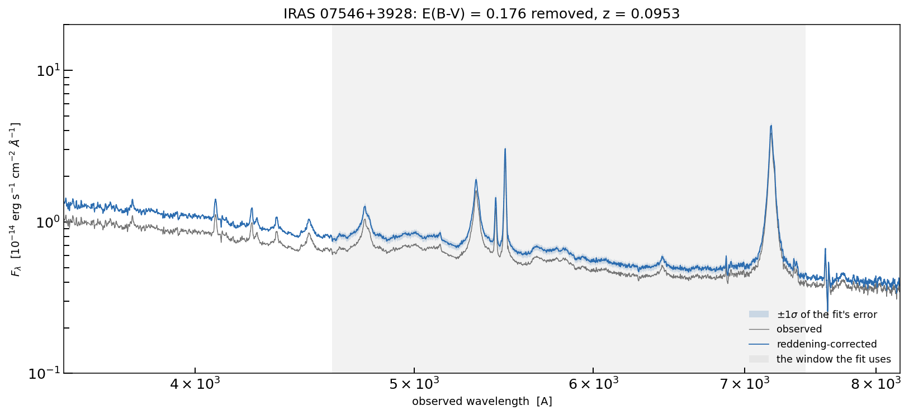
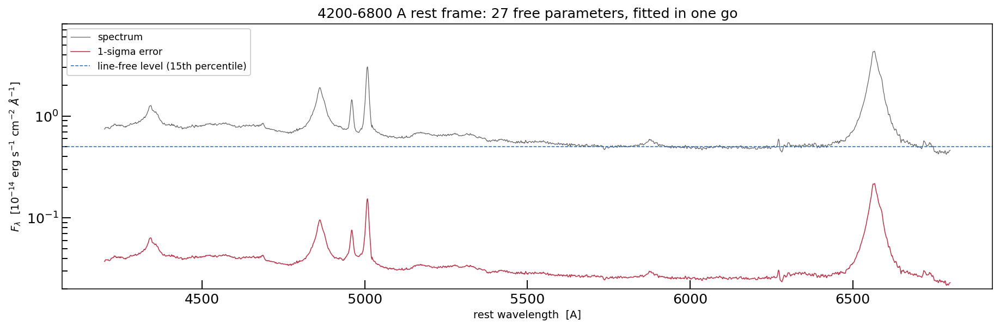
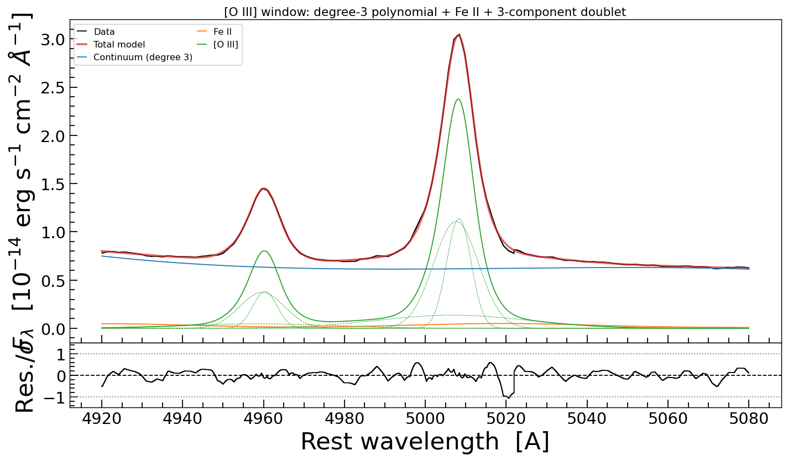
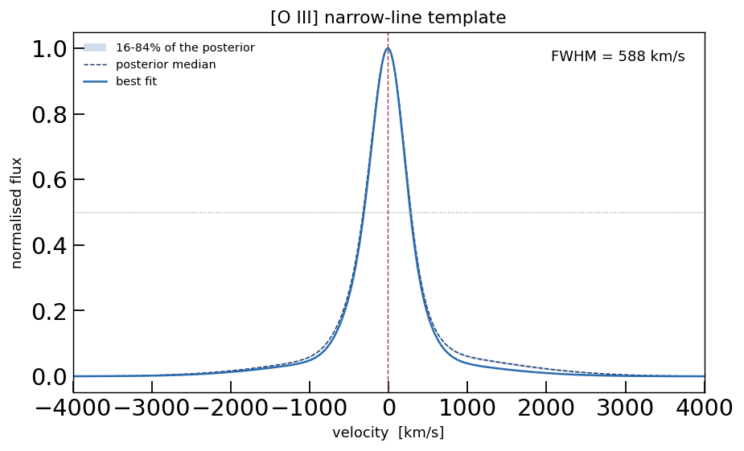
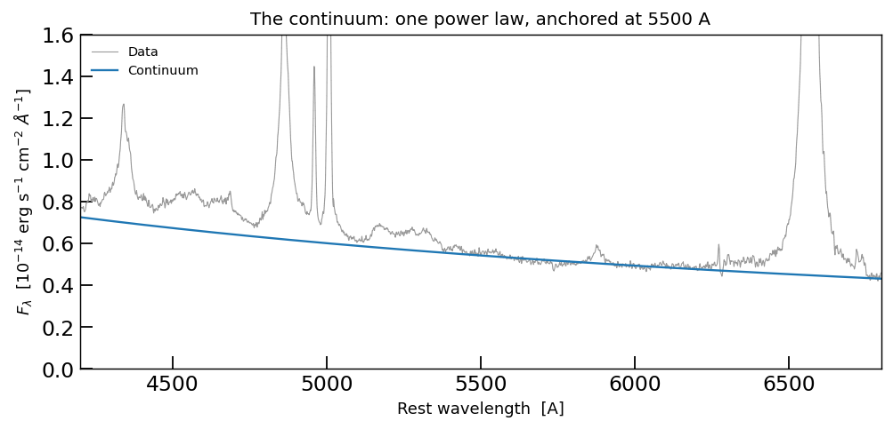
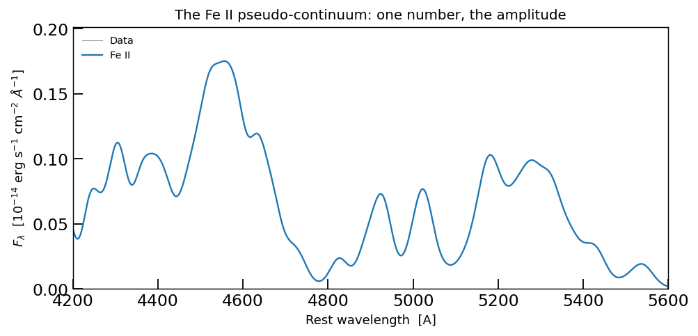
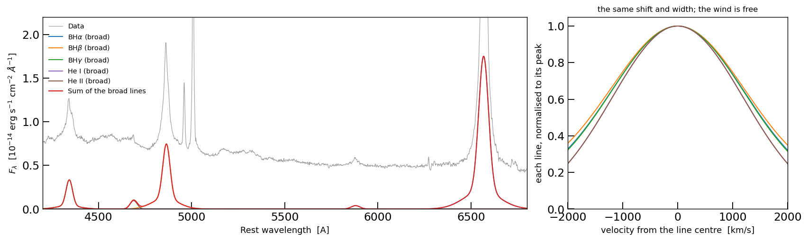
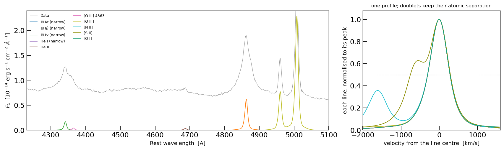

A realistic fit, start to finish
================================

One AGN spectrum, one model, one sampler, and the step before it: measuring the narrow
lines' profile. Every code block on this page is a cell of
``example/fit_iras07546_jax.ipynb`` -- the notebook builds the model literally, seventeen
constructors and then the ties, with no ``build_model()`` in the way -- so a block can be
copied into a notebook and run:

* ``example/fit_iras07546_jax.ipynb`` -- the whole fit, cell by cell: the data, the model,
  the ties, the priors, the sampler, the figures;
* ``example/fit_iras07546_o3_template.py`` -- step 2, measures the narrow-line profile on
  the [O III] doublet and writes it to a file (the code calls this *stage 1*: it is the
  first of the two fits);
* ``example/iras07546_model.py`` -- the same model as an importable module, for the three
  example scripts. ``tests/test_example_notebook.py`` executes the notebook's model cells
  and compares them with the module's, tie for tie and prior for prior, so the two copies
  cannot drift apart.

IRAS 07546+3928 at z = 0.0953: 4200-6800 A in the rest frame, 57 000 pixels at 0.046 A
sampling, H-gamma through H-alpha with the strong forbidden lines. The fit has 27 free
parameters, runs with 400 live points and ``dlogz = 0.01``, and takes about eight minutes
on one GPU.

Twelve of those 27 are narrow-line parameters -- eleven peak amplitudes and one shared
velocity shift; the narrow *profile* is not fitted at all. It is one measured object,
``example/data/iras07546_narrow_template.txt``, extracted from the [O III] doublet in
step 2 and shared by all ten narrow lines. That is what makes the parameter count 27
instead of 30, and step 2 is where the shape comes from, so it comes first.

.. contents:: On this page
   :local:
   :depth: 2

The spectrum
------------

Start with the data as it arrives, before anything is cut. IRAS 07546+3928 was observed
with a long slit and a grism, so the flux is a FITS primary array with a start wavelength
and a step in the header, and no error array: the error has to come from the spectrum
itself.

The figure shows the observed flux, the same flux with the foreground reddening removed,
and the +-1 sigma band that the fit will be given. Two things are worth reading off it.
The correction is a slope, not a rescale -- ``E(B-V) = 0.176`` is a modest Galactic
extinction, so it changes the continuum shape and leaves the lines where they are. And the
error is not noise on a smooth curve: it grows with the flux, because part of it is the
photon noise of the source itself.

   The observed spectrum (grey), the same after the Milky Way reddening is removed (blue),
   and +-1 sigma of the error the fit is given (band). The shaded region is the wavelength
   range the fit actually uses -- and it is the only range the error exists over, because
   that is where it is measured (section 1).

   The fitted window, 4200-6800 A rest frame: the spectrum, the error on its own scale
   (it rises where the spectrum does, because part of it is photon noise), and the
   line-free level the priors are scaled from -- the 15th percentile of the flux. The
   scale is logarithmic so that a 2% error and a fourfold line peak fit in one panel.

1. Read the spectrum
--------------------

Three transformations happen in one cell: the reddening correction (divide by the dust
transmission on the observed grid, i.e. multiply by ``10**(0.4 A_lambda)``, with the CCM89
law and ``E(B-V) = 0.176`` -- dust in our own Galaxy, not at the redshift of the object),
the shift to the rest frame
(``wave / (1 + z)``), and the window. The error is re-derived from the scatter of the
spectrum rather than trusted from a header: subtract a running median, take the median of
the absolute remainder in the same window -- which ignores the few pixels that belong to
emission lines -- divide by 0.6745 to turn it into a Gaussian sigma, and smooth over a few
hundred A. Then add ``PHOTON_FRACTION`` of the flux in quadrature: the photon noise of the
source, plus what the model does not describe exactly (flux calibration, the shape of the
Fe II template, departures from a pure power law).

That last step matters more than it looks, in two ways. A wrong error *scale* does not
make a fit fail; it makes every posterior too narrow or too wide by the same factor,
invisibly -- the parameter is 5% here, and it is the one number in the data step that is a
judgement. And the *order* of the operations is part of the model: the recipe reads
neighbouring pixels, so measuring it before the wavelength cut instead of after moves the
4 000 pixels at the window edges by up to 8%, which is tens of nats of evidence for a
spectrum that looks identical. The cell derives the error from the window, and
``tests/test_example_notebook.py`` asserts that this cell returns the same three arrays as
``load_spectrum()`` in ``example/iras07546_model.py`` -- bit for bit, not approximately.

.. nbcode:: ../../example/fit_iras07546_jax.ipynb
   :cell: data

2. Measure the narrow-line profile on [O III]
---------------------------------------------

A narrow emission line in an AGN is not a Gaussian. It is the virial and turbulent
kinematics of a whole region, and its profile has wings that a Gaussian cannot bend
into. Fitting a Gaussian per line therefore does two bad things at once: it spends a
free width per line on a shape the data constrain much better once, and the widths it
returns depend on which lines are bundled together.

The alternative is to measure the shape once, on the line with the most signal per
pixel, and give it to the rest with an amplitude each. [O III] 5007 is that line here:
narrow, strong, and sitting in a window where the continuum is smooth and close by.

Two decisions make the measurement a measurement rather than a choice:

* **A local fit, not a global one.** The window is 160 A, 3 505 pixels. The broad
  H-beta wing runs underneath it and would otherwise be free to reshape the narrow
  profile -- which is exactly the degeneracy that a global fit cannot avoid.
* **The iron stays in.** [O III] 5007 sits where the Fe II pseudo-continuum is still
  strong -- the published fit gives it an amplitude of 0.25, and the local fit below
  starts there. Leave it out and the window fit has nowhere to put that flux but a very
  broad wing on [O III] itself, which then goes into the template and is added under
  every narrow line.

The window's model is three objects: a degree-3 polynomial on an abscissa mapped onto
[-1, 1], the iron template, and a three-component ``Line_MultiGauss_doublet`` -- a core
plus two winds. Three components is not assumed: it is what the evidence chose between
two and three (the scan that did that is ``develop/dev_template/stage1_o3_template.py``,
a local script that is not part of this repository; what is in this repository is the
run that produces the template). The wing width is capped at 1 500 km/s, because a
broader component is indistinguishable from the continuum over this window and will
absorb it if allowed to.

.. literalinclude:: ../../example/fit_iras07546_o3_template.py
   :language: python
   :start-after: # %% model
   :end-before: # %% fit

Two details in there are worth naming, because they are the same tricks the whole
spectrum model uses later. The 5007/4959 ratio is atomic, so it is *tied* and not
fitted -- ``o3.amp_c1.tied = tie_MultiGauss_doublet_ratio("OIII", 2.98)``. And the
priors are scaled from the line-free level of the window rather than from a previous
fit, so the sampler starts from the data and not from somebody's answer.

The fit itself is four lines:

.. literalinclude:: ../../example/fit_iras07546_o3_template.py
   :language: python
   :start-after: # %% fit
   :end-before: # %% template

It prints::

   window 4920-5080 A: 3505 pixels, line-free level 0.653

   -- fit the window --
     ln Z = 7450.85 +- 0.42   (36790 iterations, 0.8 min)

The fit is good to the eye and to the residuals, but the part that matters is what
comes next -- the profile. ``gen_template`` turns the fitted doublet into a single-line
shape on a velocity grid: the core at zero velocity, the wings at their own ``dv_w``,
normalised to unit peak. The line's own ``dv_c`` is *not* part of it, because that
belongs to each line that uses the template, which is how one profile can serve H-alpha
and [O III] at the same time.

.. literalinclude:: ../../example/fit_iras07546_o3_template.py
   :language: python
   :start-after: # %% template
   :end-before: # %% verify

The grid is 8 001 points from -4 000 to +4 000 km/s, at 1 km/s -- three times finer
than the 2.8 km/s a pixel spans here, so the template does not add resolution the data
do not have. The quality control is the check at the end: the profile has to have
decayed to below 0.1% of its peak at both edges of the grid, or every narrow line would
get a truncated wing and a hard edge.

   The [O III] window fit: data, total model, the degree-3 continuum, the iron, and the
   three dashed curves that are the doublet's core and two winds. Residuals in units of
   the error in the lower panel. Drawn by ``plot_fit_jax``, which takes the dashed
   curves from the submodels themselves.

   The profile that comes out: the fitted [O III] shape in velocity space, normalised to
   unit peak, with the half-maximum marked. FWHM 588 km/s, peak 9 km/s blueward of the
   systemic velocity. The shaded 16-84% envelope of the posterior is +-1% of the peak --
   thinner than the line, and thinner than the plot's own line width.

That last sentence is the honest part of this step. The decomposition into a core and
two wings is *degenerate*: the three components trade amplitude against width at almost
constant likelihood, so the parameters of the decomposition are not individually
determined -- the posterior envelope of the profile is +-1% of the peak. What is
determined is the shape they all share, and that is the only thing the template uses.
``profile_envelope`` in the script measures that envelope by resampling the posterior
and printing it next to the profile, so "the shape is safe to freeze" is a number and
not an assumption.

The script then writes the profile to ``example/data/iras07546_narrow_template.txt``
with its provenance on top, so that a reader who finds only the file still knows where
it came from::

   # narrow-line template of IRAS 07546+3928
   # measured on the [O III] 4959/5007 doublet, normalised to unit peak
   # generated by example/fit_iras07546_o3_template.py
   # window 4920-5080 A, degree-3 local continuum, 3-component doublet, ln Z = 7450.85
   # FWHM 587.9 km/s  (sigma_equivalent 249.6 km/s), peak at -9.0 km/s
   # the frozen profile fits the window at chi2/dof = 0.086
   # col 1: velocity [km/s]   col 2: normalised flux

The ``chi2/dof`` line is a self-consistency check, not a victory: the same window is
refitted with the *frozen* profile in place of the three Gaussians, and if the profile
were a poor description of the data this number would be orders of magnitude above the
0.086 the free fit reaches. The frozen profile is a smoother description, so it is not
expected to be identical -- only close.

3. Build the model, one component at a time
-------------------------------------------

The whole-spectrum model is seventeen additive components of three kinds: a power-law
continuum, the Fe II template, and fifteen lines. An astropy model composes with ``+``,
a ``galspec.jax_models`` model composes the same way, so the model is built by naming the
parts one after another and summing them. There is no builder function, and every piece
stays a model object that can be called on a wavelength array on its own -- which is what
lets the four figures below draw each chunk of the model from the fitted parameters.

3.1. The continuum
~~~~~~~~~~~~~~~~~~

One power law over 2 600 A: an amplitude and a slope. It is anchored at 5500 A, in the
middle of the range, so that amplitude and slope are nearly independent -- move the
anchor to the blue end and the two parameters become a line's intercept and gradient,
correlated at the 0.99 level.

.. nbcode:: ../../example/fit_iras07546_jax.ipynb
   :cell: model_continuum

   The continuum alone, drawn from the fitted parameters, against the data. ``alpha``
   comes out at 1.07 in F-lambda, which is a slope of -0.93 in F-nu -- redder than a
   bare quasar's -0.5, the starburst showing through.

3.2. The Fe II template
~~~~~~~~~~~~~~~~~~~~~~~

The Fe II pseudo-continuum is not a line: it is a forest of blends between 4 200 and
5 600 A that no individual transition can be fitted. It is used as a template --
``IronTemplate_tied`` -- convolved with a broadening kernel and scaled by one number.
It is not a small correction: in the fit below it reaches 0.18 at 4 556 A against a
continuum of 0.66, a quarter of the total, and that structure has to go somewhere. A
model without it gives the flux to whatever else is nearby -- the continuum, or a wing
on the nearest broad line.

The kernel is a ``Line_MultiGauss`` the compound model does not own; its parameters are
tied in section 4.3, which is why the iron costs exactly one free parameter -- its
amplitude.

.. nbcode:: ../../example/fit_iras07546_jax.ipynb
   :cell: model_iron

   The Fe II pseudo-continuum under H-beta, [O III] and H-gamma, from the fitted
   amplitude. The wiggles are the template's own structure; what the fit decides is the
   broadening (section 4.3) and the amplitude.

3.3. The broad lines
~~~~~~~~~~~~~~~~~~~~

Three Balmer lines and two helium lines. Each Balmer line is a core plus a wind:
``n_components=2`` puts ``amp_c``/``dv_c``/``sigma_c`` and
``amp_w0``/``dv_w0``/``sigma_w0`` in one constructor call. He I 5876 and He II 4686 are
weak enough to be one Gaussian each.

What is *not* in this cell is as important as what is: no ties yet. The pieces are built
loose and tied afterwards, because a tie resolves its reference by name at evaluation time
and does not need the compound model to exist.

.. nbcode:: ../../example/fit_iras07546_jax.ipynb
   :cell: model_broad

   Left: the five broad components and their sum, from the fitted parameters. Right: the
   same five lines aligned on their peaks and normalised. The shift and the width are
   shared, so the curves nearly coincide; what separates them is the wind amplitude,
   which is free per line -- the Balmer decrement of the wind, and a measurement.

3.4. The narrow lines
~~~~~~~~~~~~~~~~~~~~~

Ten lines, all on the measured profile. The template is read from the file and handed to
each line as ``template_velc`` and ``template_flux``; a line that uses it has an amplitude
and a shift, and no width anywhere, because the profile carries it. A forbidden doublet is
one component with two peaks: the second amplitude is the atomic ratio (tied in section 4)
or, for [S II], free, because 6716/6731 measures the electron density.

.. nbcode:: ../../example/fit_iras07546_jax.ipynb
   :cell: model_narrow

   Left: where the ten narrow lines sit, each with its amplitude from the fit. Right: the
   same ten, aligned on their peaks and normalised -- one curve, not ten, which is the
   whole point of the template. The offset curves are the doublets keeping their atomic
   separation: [N II] at -1 594 km/s, [S II] at -670 km/s.

3.5. The sum
~~~~~~~~~~~~

The seventeen pieces are summed in a fixed order -- narrow and broad alternating, so that a
reader finds [O III] next to H-beta rather than in a block at the end -- and then given
display names, because a legend should say ``BH$\alpha$ (broad)`` and not ``b_halpha``.

.. nbcode:: ../../example/fit_iras07546_jax.ipynb
   :cell: model_sum

4. The ties
-----------

A tie is not a constraint in the sampler: it removes a parameter. The tied parameter is
computed from another model's parameter at evaluation time, so the sampler never sees it
and no likelihood penalty enforces it. The ``jxm.tie.*`` objects look the reference up by
name, which is why they can be assigned before or after the pieces are summed.

4.1. Tying the narrow lines: one shift, one ratio per doublet
~~~~~~~~~~~~~~~~~~~~~~~~~~~~~~~~~~~~~~~~~~~~~~~~~~~~~~~~~~~~~

The narrow lines share a velocity: eleven peaks become one measurement of the
narrow-line-region systemic velocity, and no line can drift on its own. The second peak
of a forbidden doublet is not fitted at all, because the ratio is atomic.

.. nbcode:: ../../example/fit_iras07546_jax.ipynb
   :cell: ties_narrow

Tying every narrow shift is a statement rather than a measurement: a line that really
sits at a different velocity is absorbed into its amplitude and into the residual, and
the model cannot report it. These lines do come from the same gas, so it is a good bet
-- but it is the kind of assumption worth writing down rather than leaving implicit in
the code. The right-hand panel of the narrow-line figure above is what it buys: ten
curves that are one curve.

4.2. Tying the broad lines: one shape, three amplitudes
~~~~~~~~~~~~~~~~~~~~~~~~~~~~~~~~~~~~~~~~~~~~~~~~~~~~~~~

Broad H-beta and H-gamma follow H-alpha component by component: the core's shift and
width, and every wind's shift and width. What is *not* tied is the amplitude, of the
core or of the wind -- the Balmer decrement is a measurement, and it is one of the
things this fit is for.

.. nbcode:: ../../example/fit_iras07546_jax.ipynb
   :cell: ties_broad

This is the "one broad-line region" assumption, and it is the one
``example/fit_iras07546_jax_tied.py`` tests: that script releases the eight parameters
removed here, puts a Gaussian on the difference instead of a tie, and reports how far
each line moved in units of that width (:doc:`priors` has the construction and the
result -- H-gamma's wind is the one that disagrees).

4.3. Tying the iron template: its kernel *is* broad H-alpha
~~~~~~~~~~~~~~~~~~~~~~~~~~~~~~~~~~~~~~~~~~~~~~~~~~~~~~~~~~~

The iron is a template convolved with a broadening kernel. Every parameter of that
kernel -- core shift and width, wind shift and width -- is tied to the broad H-alpha
component, which is the strongest statement in the model: the iron lines come from the
same gas as the Balmer line, so they cannot have a velocity structure the Balmer line
does not have.

.. nbcode:: ../../example/fit_iras07546_jax.ipynb
   :cell: ties_iron

Why tie rather than fit the kernel? Because a free kernel width lets the iron absorb Fe
II flux into a fake wind, and earlier fits of this object did exactly that -- the
narrow lines were fitted well and the broad profile was quietly wrong. With the kernel
tied, the iron costs exactly one free parameter, its amplitude.

The three cells of this section take the model from 56 parameters to 32 (the narrow ties)
to 27 (the broad and iron ties); the printouts at the end of each one say so.

5. A prior for every parameter
------------------------------

One prior per free parameter, and every one of them is scaled from the spectrum rather than
copied from a previous fit, so the recipe transfers to another object without hand-tuning.

Two shapes do the work. ``LogUniform`` gives equal probability per factor of ten, which is
what a line peak that may be four decades fainter than the brightest pixel needs -- a
linear box would put 99% of its prior at the bright end and never visit the faint lines.
``Uniform`` is right for a quantity whose natural range is already the physical one: a
velocity shift, a width, or a ratio bounded by 1.

The dictionary is written out parameter by parameter, because that is the thing a reader
edits to fit their own object; the loop after it is the entire mechanism. It ends by
walking every free parameter and asserting that each one has a prior: a fit with an unset
prior is a silent bug -- the parameter samples its whole default box -- and the assertion
turns that into an error before the sampler starts.

.. nbcode:: ../../example/fit_iras07546_jax.ipynb
   :cell: priors

The recipe is written out on :doc:`priors`, which also explains what each shape does and
how to make one parameter's prior depend on another's.

6. Run the sampler
------------------

Nested sampling on the GPU. ``nlive`` live points are drawn from the prior and the worst
one is repeatedly replaced with a point of higher likelihood: the volume shrinks, the
likelihood rises, and the integral of both is the evidence. The surviving points are a
weighted sample of the posterior, which is what everything below quotes. The run stops
when less than ``dlogz`` of the evidence may remain unseen.

.. nbcode:: ../../example/fit_iras07546_jax.ipynb
   :cell: sampler

Before spending the runtime, a check: draw parameter sets from the priors alone and look
at the band they span. If the data sit inside it, the prior contains the answer -- which
is why no least-squares seed is needed and the starting values in the model do not matter.

.. nbcode:: ../../example/fit_iras07546_jax.ipynb
   :cell: prior_check

.. nbcode:: ../../example/fit_iras07546_jax.ipynb
   :cell: run

It prints::

     log Z = 130678.63 +- 0.58   (59786 iterations, 7.9 min)

and the next cell adds the residual::

     chi2/dof = 0.315, residual rms 0.56 sigma, worst pixel 3.9 sigma

JNesty seeds its live points from a fixed key, so a rerun visits the same points. That is
not bitwise identity -- the same fit run twice comes out a nat apart, from the last bits of
a float sum feeding the sampler's ordering -- but it does mean the quoted uncertainty is
the *sampler's* error bar, and the run-to-run scatter sits well inside it.

7. Present the results
----------------------

The table is the answer: posterior median and the 16th/84th percentiles, a 68% credible
interval, the Bayesian counterpart of "1 sigma".

.. nbcode:: ../../example/fit_iras07546_jax.ipynb
   :cell: table

Read it with the ties in mind -- ``OIII.dv_c`` is the shift of *every* narrow line, and
``b_halpha.sigma_w0`` is the width of the wind in *all three* Balmer lines, in He I and in
the Fe II kernel. The unit column is read off the parameter's suffix, so nothing has to be
remembered: ``amp*`` is a flux density, ``dv*``/``sigma*`` is km/s, ``amp_w*`` is a ratio to
the core.

Note what is **not** in the table: any narrow-line width. The ten narrow lines contribute
twelve numbers -- eleven peaks (six singlets, four doublet main peaks and both peaks of
[S II]) and one shared shift -- where a Gaussian per line spends a width on top of that.
The 27-parameter count against the published model's 30 comes from exactly there.

The comparison against the published model, and the widths and fluxes a paper would quote:

.. nbcode:: ../../example/fit_iras07546_jax.ipynb
   :cell: scoreboard

.. nbcode:: ../../example/fit_iras07546_jax.ipynb
   :cell: fluxes

A flux is a combination of parameters, so it is computed per posterior sample rather than
from the medians: that is how its error bar inherits the correlations in the fit. The
narrow-line flux needs the template's area on the velocity grid, which is read once off the
profile -- the same area for all ten lines, since they share the shape.

.. nbcode:: ../../example/fit_iras07546_jax.ipynb
   :cell: fit_figure

.. figure:: _static/example_figures/iras07546_jax_fit.png
   :width: 100%

   The full 4200-6800 A window: data, total model, and every component underneath it,
   with the broad lines' cores and winds drawn as dashed curves in the colour of the
   line they belong to. The lower panel is the residual in units of the error, with the
   +-1 sigma guides.

Three windows: 870 A, 380 A and 250 A wide, against the 2 600 A in the figure above. On
that page a 700 km/s narrow core is two pixels; here it is a profile, and the wings of
the broad lines are visible at all.

.. nbcode:: ../../example/fit_iras07546_jax.ipynb
   :cell: zooms

.. figure:: _static/example_figures/iras07546_jax_fit_Hgamma_Hbeta.png
   :width: 95%

   H-gamma + H-beta with the [O III] doublet.

.. figure:: _static/example_figures/iras07546_jax_fit_Halpha_NII_SII.png
   :width: 95%

   H-alpha with [N II] and [S II]. The narrow lines sit on broad wings that the model
   does not try to fit with the same component, and the two dashed purple curves are
   broad H-alpha's core and wind, drawn separately.

.. figure:: _static/example_figures/iras07546_jax_fit_HeI_NaD.png
   :width: 95%

   He I 5876 and Na D, the faintest features in the model.

The posterior itself: one histogram per parameter, and the joint distribution of the
parameters that a reader is most likely to want a covariance for.

.. nbcode:: ../../example/fit_iras07546_jax.ipynb
   :cell: corner

.. nbcode:: ../../example/fit_iras07546_jax.ipynb
   :cell: histograms

.. figure:: _static/example_figures/iras07546_jax_histograms.png
   :width: 100%

   Marginal posteriors, with the prior range marked on each panel.

.. figure:: _static/example_figures/iras07546_jax_corner.png
   :width: 75%

   The joint posterior of the parameters the fit is most sensitive to.

8. Save it, and read it back
----------------------------

A nested-sampling run is expensive; the file should be the thing you keep. One FITS holds
the samples and their weights, their unit-cube coordinates, the evidence and its error, the
parameter names, bounds and priors, the sampler's convergence trajectory, the model
description and the spectrum that was fitted -- everything the figures above are drawn
from. Reloading gives a :class:`galspec.JNesty_Fit` whose quantiles, best fit and plots work
unchanged.

.. nbcode:: ../../example/fit_iras07546_jax.ipynb
   :cell: save

.. nbcode:: ../../example/fit_iras07546_jax.ipynb
   :cell: readback

What is in the file -- and the one thing that cannot be stored, a prior written as a plain
Python function -- is on :doc:`jax_gpu`; the priors that went into it are on :doc:`priors`.
The same fit driven from a configuration file instead of a notebook is :doc:`config_fit`:
that is what to reach for when the model is the same and the spectra are many.

9. What the numbers say
-----------------------

The comparison printed in section 7 is the point of writing the model this way:

.. code-block:: text

     model                       free         ln Z  chi2/dof
     --------------------------------------------------------
     published                     30    130889.60     0.307
     template                      27    130677.27     0.315
    *this run                      27    130678.63     0.315
                                        Delta = -210.97 nats against the published Gaussian model

The published model is the same spectrum, the same continuum, the same broad lines and
the same priors, with a Gaussian per narrow line and one width shared between them. The
only difference is the narrow-line profile, so the 211 nats are the price of that
assumption -- not of the code: the templated model fits [O III] itself better, and a
second, independently written implementation of the same model agrees to a hundredth of
a nat. This run lands about a nat from the stored ``template`` row, inside its 0.58
error bar -- see :doc:`priors` on why the fixed key does not buy bitwise identity -- and
re-extracting the template moves the evidence by more than that again, so the comparison
is between runs made on the same template file.

The reason is measurable rather than mysterious. The same local treatment applied to
narrow H-alpha instead of [O III] gives a width of about 300 km/s, against an equivalent
249.6 km/s for the [O III] profile -- a ratio of 0.84. The narrow Balmer lines in this
object are broader than [O III], so a profile measured on [O III] and stamped under
H-alpha, the strongest narrow line in the spectrum, under-fits it. The residual is not
flat across that line: it runs at -0.6 sigma over the core and +2.3 sigma on the red
shoulder (6570-6580 A), which is the signature of a shape very slightly too narrow and
too peaked for this line -- and it is what the H-alpha zoom above shows. A Gaussian
model with one free common width can split the difference; a frozen profile cannot.

That ratio was measured with the portability check in
``develop/dev_template/stage1_o3_template.py``, the local script that also scanned the
component count; it is not part of this repository, so treat the number as provenance
rather than as something the page reproduces. That is a result about IRAS 07546+3928 and
a lesson about the method, and it is worth knowing before reaching for a template:
**measure the profile on the line you trust, then check that the other lines share it**.
For the forbidden lines alone, which do share their kinematics, the extraction is sound
and the model is the right one; for a Balmer-dominated narrow-line region, anchor the
template on a Balmer line instead.

The [S II] ratio that comes out of the fit is 0.0625/0.0333 = 1.88, measured rather than
tied (it is a density diagnostic), and the [N II] and [O I] ratios are at their atomic
values because nothing physical varies them.

Where to go next
----------------

* ``example/fit_iras07546_jax.ipynb``: this page, cell by cell. Copy a cell, change a
  number, run it -- the model has no builder function to look up.
* ``example/fit_iras07546_o3_template.py``: step 2 on its own -- the window fit, the
  profile, and the file the whole-spectrum fit reads.
* ``example/iras07546_model.py``: the same model as an importable module, shared by the
  three fitting scripts. ``tests/test_example_notebook.py`` holds it to the notebook.
* ``example/fit_iras07546_jax_tied.py``: the same fit with the Balmer kinematics
  released and centred on H-alpha, which turns "the lines share one profile" into a
  measurement (:doc:`priors` has the construction and the result).
* ``example/fit_iras07546_jax_toggle.py``: how many broad components the profile needs,
  decided by the sampler rather than assumed -- four on this object, with every sample
  agreeing (:doc:`priors` has the numbers).
* :doc:`jax_gpu`: the JAX backend, the batching, and the CPU-versus-GPU comparison.