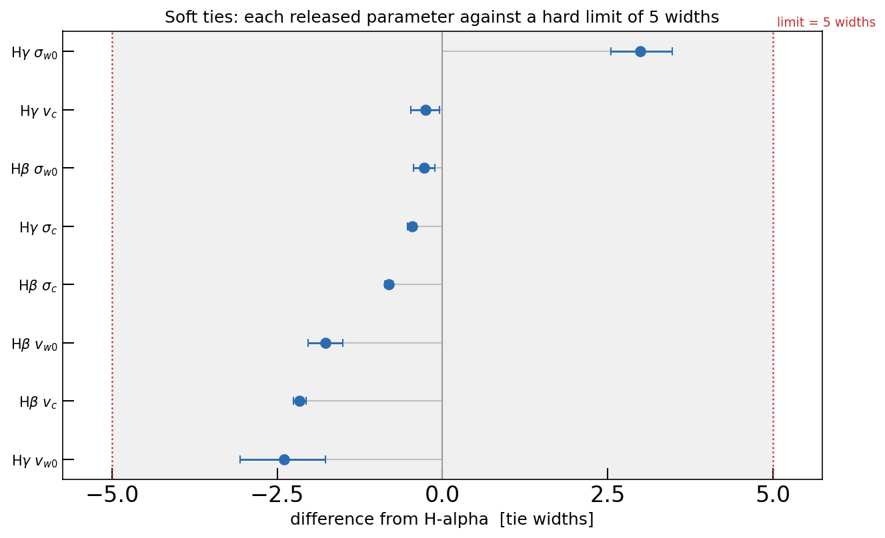
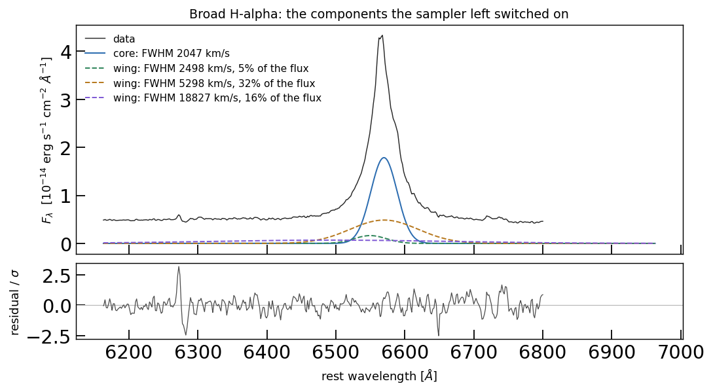
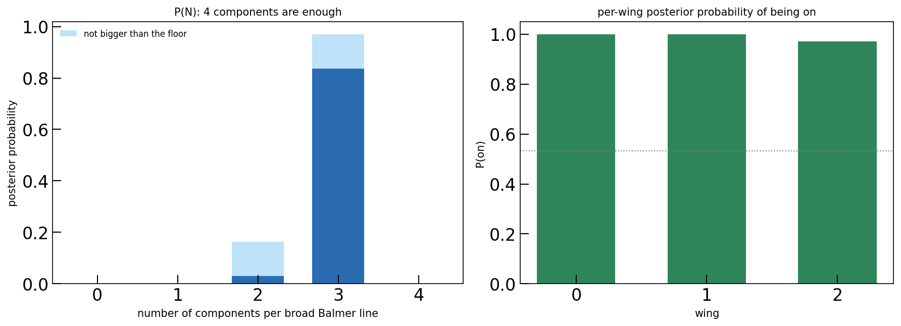

Priors
======

A prior says two things about a parameter: where it may be, and how likely each value
in that range is. In GalSpec it is set on the parameter itself -- the attribute astropy
already reserves for the user's fitter -- so the prior sits next to the thing it
describes instead of in a dictionary passed to the sampler at call time::

   model.sigma_w0.prior = priors.Uniform(300.0, 8000.0)

This page covers the shapes that exist, what the fitter does with them, and three
worked examples taken from ``example/``: the published recipe, a prior centred on
another parameter, and a prior that can switch a component off entirely. For the fit
those priors belong to, see :doc:`fitting_walkthrough`.

.. contents:: On this page
   :local:
   :depth: 1

The four shapes
---------------

.. code-block:: python

   from galspec import priors

   model.amplitude.prior = priors.LogUniform(1e-3, 30.0)   # flat per decade
   model.sigma_c.prior   = priors.Uniform(300.0, 8000.0)   # flat in the value
   model.amp_w0.prior    = priors.Uniform(0.0, 1.0)        # a ratio: bounded
   model.amp_w1.prior    = priors.SpikeAndSlab(p_off=0.5)  # may be exactly zero

   # a prior that names another parameter: broad H-beta's wind shift is centred on
   # broad H-alpha's, with 5% of H-alpha's wind width as its sigma and five of those
   # widths as a hard limit
   model.set_prior("b_hbeta.dv_w0",
                   priors.Normal(mean="b_halpha.dv_w0", sigma=0.05,
                                 scale_from="b_halpha.sigma_w0", nsigma=5))

.. list-table::
   :header-rows: 1
   :widths: 18 34 48

   * - shape
     - use it when
     - in the published recipe
   * - ``Uniform(lower, upper)``
     - the range is already the physical one
     - every width, shift and ratio; the continuum power-law index
   * - ``LogUniform(lower, upper)``
     - the parameter spans decades
     - every line peak, and the iron amplitude: from invisible to three times the
       brightest pixel
   * - ``Normal(...)``
     - the value is expected near a number, or near **another parameter**
     - the soft tie (below)
   * - ``SpikeAndSlab(p_off)``
     - the parameter may be *absent*, not merely small
     - the wing gate in the component-count run (below)

A parameter whose prior is never mentioned is uniform over its default bounds, and the
examples refuse to start in that state -- a stray parameter then samples its whole box
and the run looks fine while it happens.

A centred prior, in detail
--------------------------

``priors.Normal`` returns a :class:`galspec.CenteredPrior`; ``mean`` is a number or the
name of another parameter. The width of the Gaussian can be written three ways:

* **absolute** (default): ``sigma`` is in the parameter's own units;
* ``relative=True``: ``sigma`` is a fraction of the *centre's* value, so the prior
  widens with the profile it is centred on;
* ``scale_from="name"``: ``sigma`` is a fraction of *that* parameter's value -- how a
  shift is constrained in units of a line width.

``log=True`` makes it multiplicative (a log-normal), the right shape for an amplitude;
it cannot be combined with ``relative``, because in log space ``sigma`` is already a
fraction.

``nsigma`` is a **hard** limit, not a suggestion: beyond it the prior is exactly zero.
The default is seven, where 1.3e-12 of the Gaussian's mass is left and float64 can no
longer tell a cumulative probability from 1. The prior is truncated to the parameter's
own box *intersected* with that range, so when the box is narrower, the box wins. A
posterior that piles up against a hard limit is then a bound on the parameter, not a
measurement of it -- which is why the tied example reports how much of the posterior
sits there.

What the fitter does with them
------------------------------

**A prior is a transform of the unit cube.** The sampler draws ``u`` in [0, 1] and the
prior maps it one-to-one onto the parameter's range, carrying the Jacobian inside the
transform. Because the map is a bijection and not a sampling density, the number the
run reports is the evidence of *the stated prior* -- nested sampling's prior volume
stays meaningful.

**Dependencies are resolved, not assumed.** A prior that names another parameter must be
drawn after it. :func:`galspec.resolve_prior_dependencies` resolves names (flat, then
qualified, then a unique bare match -- an ambiguous one is an error rather than a guess),
rejects cycles, and returns an order in which independent parameters keep their original
position, so a model without centred priors transforms exactly as it did before. Both
fitters walk that order, and ``tests/test_priors_tied.py`` asserts they agree to 1e-9.

**Log-scaled parameters are truncated in log space.** An amplitude's box is stored in
log10 units, so the truncation range is exponentiated before it reaches the prior; the
fitters do that, or a tie silently lands in the wrong place.

The published recipe
--------------------

``set_priors`` in ``example/iras07546_model.py``, condensed:

.. list-table::
   :header-rows: 1
   :widths: 24 30 46

   * - what
     - range
     - why that shape
   * - line peaks
     - 1e-3 to 3x the brightest pixel, **log-uniform**
     - four decades, from invisible to implausibly strong
   * - wind / core ratio
     - 0-1, uniform
     - no wind is brighter than its own core
   * - narrow shift
     - +-1000 km/s, uniform
     - one shift shared by every narrow line, measured from [O III].  There is no
       narrow *width* to give a prior to: it is in the measured template, which is
       what makes the narrow lines one number each instead of three.
   * - [S II] 6716/6731 ratio
     - both peaks log-uniform, free
     - it is a density diagnostic, not an atomic constant -- unlike [O III], [N II]
       and [O I], whose ratios are tied
   * - broad shifts
     - core +-2 500, wind +-6 000 km/s, uniform
     - a core within a few widths of rest, a wind free to be offset by more
   * - broad core *and* wind
     - 300-8000 km/s, uniform
     - one box for both: a wing is not assumed broader than its core, and a 25 000 km/s
       ceiling only puts prior where the data are not
   * - continuum level
     - 0.2-4x the line-free windows, log-uniform
     - cannot be negative, cannot swamp the lines
   * - Fe II amplitude
     - 1e-3 to 3x the continuum level
     - the only free iron parameter

Worked example: a prior centred on another parameter
----------------------------------------------------

The three Balmer lines come from the same gas, so the published fit *ties* broad
H-beta's and H-gamma's shifts and widths to broad H-alpha's. A tie is an absolute
statement: the tied parameter cannot disagree, so the fit cannot report whether the tie
was right, and a real difference would be absorbed silently by the amplitudes.

The alternative is not to free all eight parameters -- the *difference* between two
widths is then dominated by whatever the data cannot constrain. What is wanted is "near
H-alpha's value, and not farther than this":

.. code-block:: python

   # a width: 20% of H-alpha's width, at most five widths away
   model.set_prior("b_hbeta.sigma_c",
                   priors.Normal(mean="b_halpha.sigma_c", relative=0.20, nsigma=5))
   # a shift: 5% of that component's H-alpha *width* (not of the shift, which can be
   # near zero), used as the standard deviation
   model.set_prior("b_hbeta.dv_c",
                   priors.Normal(mean="b_halpha.dv_c", sigma=0.05,
                                 scale_from="b_halpha.sigma_c", nsigma=5))

That is the whole construction, and ``example/fit_iras07546_jax_tied.py`` is the worked
fit with it applied: 35 free parameters instead of 27, with ``WIDTH_FRACTION = 0.20``,
``SHIFT_FRACTION = 0.05``, ``MAX_SIGMA = 5.0`` and ``CAP_TOLERANCE`` (when a pull counts
as sitting on the limit) as named constants at the top of the file.

The number to read is the **pull** -- the difference from H-alpha's value in units of
the tie width. A pull of zero means the data agree with the tie; a pull of one means the
difference is as large as the prior allowed for; a pull of five or more means the data
asked for more than the prior permits, and the fitted value is a compromise rather than
the likelihood's own answer.

The evidence moves too, and its sign has to be read carefully. For a Gaussian of width
:math:`\sigma_{\rm tie}` against a posterior of width :math:`\sigma_{\rm post}`, each
released parameter costs

.. math::

   \Delta \ln Z \;\approx\; \ln \frac{\sigma_{\rm tie}\sqrt{2\pi}}{\sigma_{\rm post}} ,

which for the eight parameters is +21.5 *if the tie is right* (the script computes it
from each parameter's own posterior width). A drop of that size is the expected cost of
a freedom the data did not need; a rise means the likelihood gained more than the prior
volume cost, i.e. the tie was wrong.

   Each released parameter against H-alpha, in tie widths. The shaded band is where the
   prior allows the difference, the red lines its hard limit at five tie widths, and
   every point lies inside both.

On IRAS 07546+3928 the answer is measured, and it is not the answer the previous
generation of this page gave -- which is the useful part. The eight released
parameters (H-beta and H-gamma, core and wind, width and shift) split three ways:

.. list-table::
   :header-rows: 1
   :widths: 26 14 14 14 14 14

   * - parameter
     - H-alpha
     - line
     - difference
     - fractional
     - pull
   * - ``b_hbeta.sigma_c``
     - 1 227.6
     - 1 029.4
     - -198.2
     - -16.1%
     - -0.81
   * - ``b_hbeta.dv_c``
     - 234.8
     - 102.2
     - -132.7
     - -56.5%
     - -2.16
   * - ``b_hbeta.sigma_w0``
     - 4 214.2
     - 3 978.2
     - -235.4
     - -5.6%
     - -0.28
   * - ``b_hbeta.dv_w0``
     - -398.4
     - -770.5
     - -372.6
     - -93.5%
     - -1.77
   * - ``b_hgamma.sigma_c``
     - 1 227.6
     - 1 114.6
     - -112.8
     - -9.2%
     - -0.46
   * - ``b_hgamma.dv_c``
     - 234.8
     - 218.9
     - -15.9
     - -6.8%
     - -0.26
   * - ``b_hgamma.sigma_w0``
     - 4 214.2
     - 6 732.7
     - +2 522.9
     - +59.9%
     - **+2.99**
   * - ``b_hgamma.dv_w0``
     - -398.4
     - -903.2
     - -504.3
     - -126.6%
     - -2.39

The four **core** parameters agree with H-alpha's -- pulls inside 0.9 for the widths
and 2.2 for the shifts -- so for the narrow cores the hard tie was right and could
have stayed. The four **wind** parameters are where the two lines differ: H-beta's
wind is H-alpha's within a third of a tie width in width and 1.8 in shift, but
H-gamma's is 60% broader and 504 km/s bluer, at +2.99 of its five-width window.

The soft fit comes out **+833.21 +- 0.71** above the hard tie: the eight parameters
bought about 863 nats of likelihood (``chi2/dof`` 0.315 -> 0.285 over 56 921 degrees
of freedom) and cost 21.2 in prior volume. 863 - 21.2 = 842 against the measured 833,
which agrees to the accuracy of a chi2/dof printed to three digits (0.001 of it is
57 nats). The evidence went into the likelihood, not into book-keeping.

Two things about that number are worth stating plainly, because it is larger than the
pulls suggest and it is the kind of result that gets over-read:

* **A 3.0-sigma pull plus an 833-nat evidence gain is not a contradiction.** The pulls
  are per parameter and are measured relative to H-alpha's *value*; the evidence is
  the joint likelihood gain from re-shaping three line profiles at once, and a change
  of a few per cent in a broad wing that spans 1 500 A moves a lot of pixels. The
  eight parameters are also correlated -- H-beta's shifted wind and H-alpha's width
  trade against each other -- so no single pull carries the gain.
* **Nothing here sits against a hard limit.** In the earlier version of this page the
  two wind widths piled up on the 8 000 km/s ceiling of the width prior, which is a
  prior artefact and not a measurement; with the narrow lines described by the
  measured [O III] template (see :doc:`fitting_walkthrough`) the released widths come
  out at 3 978 +- 94 and 6 733 +- 330 km/s, both inside the box, with none of their
  posterior against either wall. The released parameters are therefore measurements,
  which they were not before.

H-alpha's own numbers move a little when the ties are released, and the size of that
move is the honest error bar on the tie assumption:

.. list-table::
   :header-rows: 1
   :widths: 30 22 22 18

   * - parameter
     - hard tie
     - soft tie
     - difference
   * - ``b_halpha.sigma_c``
     - 1 194 +- 6
     - 1 228 +- 8
     - 34 (3 sigma)
   * - ``b_halpha.sigma_w0``
     - 4 316 +- 41
     - 4 214 +- 61
     - 102 (2 sigma)

Three per cent, and the shifts move by less (234.8 against 209.4). So the answer is not
sensitive to whether the tie holds -- what is sensitive is the evidence, and that is
the quantity the tie was deciding.

A gain that size is worth checking against the sampler before it is quoted, and the
control is cheap. JNesty seeds its live points from a fixed key, so a rerun visits the
same live points -- but bitwise identity is not what comes back: two runs of this fit
on the same GPU differed by 0.45 nats, which is inside the error bar, from the last
bits of a GPU sum feeding the sampler's ordering. The 27-parameter fit repeats to about
the same tolerance (three runs span 1.8 nats). What also
matters is the live-point count: rerunning the hard-tie fit at 1 000 points instead of
400 moved it by 2 nats with the same posteriors. So the honest error on a single
evidence is a few nats rather than the 0.6 the run reports -- and this difference is
larger by two orders of magnitude. The soft fit runs at 1 000 live points, which is why
its error bar (0.40) is *smaller* than the hard fit's (0.58) despite having eight more
parameters.

Two caveats belong with the numbers above:

* **The tie width is a physical statement, and it is the choice that decides the
  answer.** 20% of the width says the two profiles move like the same gas to within a
  fifth; a galaxy whose H-beta region really were twice as broad as its H-alpha region
  would show pulls of ~5 and would be reported as such, not smoothed away.
* **Component *i* is tied to component *i*.** With one wind per line the pairing is
  unambiguous; with more it is a choice, and the example pairs them in order.

Worked example: switching a component off
-----------------------------------------

How many broad components does a profile need? The alternative to fitting ``k`` and
comparing evidences is to let the sampler decide: give the line ``k`` components and let
every component after the first carry a *toggle* prior -- with some probability its
amplitude is **exactly zero**.

Nothing special is needed in the models: ``Line_MultiGauss(n_components=k)`` is a core
plus ``k - 1`` wings, each with its own amplitude ratio, shift and width.

.. code-block:: python

   # a spike at exactly zero (probability 0.2), else a linear slab on (0, 1]
   for name in ("b_halpha", "b_hbeta", "b_hgamma"):
       model.set_prior(f"{name}.amp_w0", priors.SpikeAndSlab(p_off=0.2, lower=0.0,
                                                            upper=1.0))

The zero is **exact**, not small. That is what makes it work: a point mass has *finite*
prior volume -- ``p_off`` of the cube -- while a density on the reals has none. A nested
sampler can find a region of finite volume; it could never find a point of measure zero.
The Bayes factor of the component follows from the prior odds it was given:

.. math::

   \mathrm{BF} = \frac{P(\text{on})/P(\text{off})}{(1 - p_{\rm off})/p_{\rm off}} .

Dividing the prior odds out matters: with a ladder of ``p_off`` the higher components are
*a priori* unlikely and would otherwise look rejected for that reason alone.

A component that is switched off is unambiguous. One that is *barely* on is not: at 1%
noise an unneeded Gaussian can sit at 1% of the core peak and buy a little chi-square
from the noise, with a Bayes factor of ~400 in favour. So the *count* is defined with a
floor -- 3% of the core peak in the example -- and the fit still puts posterior mass
between zero and the floor. The floor is part of the definition of "needed", not a hidden
prior.

The recipe, as ``example/fit_iras07546_jax_toggle.py`` applies it:

* only the three Balmer lines get four components; He I and He II keep one broad
  Gaussian, and the Fe II kernel follows broad H-alpha. 37 free parameters -- six
  fewer than the Gaussian narrow-line version of this fit, because the narrow lines are
  one measured profile with one shift (``example/iras07546_model.py``);
* one width prior for everything, 300-8000 km/s, the same box as the published fit --
  a wing is not required to be broader than the core;
* a ladder ``p_off = 0.2, 0.5, 0.7``. The likelihood cannot tell two wings apart
  (exchanging them leaves the spectrum bit-identical), so the prior is the only place an
  asymmetry can live;
* decide by the *mode* of the floored count, then refit at that ``k`` with plain priors
  if an evidence is wanted.

   The four components the run reports for broad H-alpha, sorted by width.

   Where the count comes from: left, the posterior on how many components the profile
   needs (1.000 for four); right, the probability that each of the three wings is on.

The answer on IRAS 07546+3928: the run asked for at most four broad components and
returned **four** -- a core plus three wings. All 211 675 equally weighted samples have
all three wings on *and* all three above the 3% floor, so ``P(3 wings) = 1.000`` and
every Bayes factor is unbounded above: with the narrow lines described by the measured
template rather than a Gaussian each, the count is not a marginal call at all. (The
same model with Gaussian narrow lines returned 0.84 here, so the pixels that voted
against the widest wing were being used to pay for the narrow-line mismatch.) Sorted by
width, broad H-alpha comes out as:

.. list-table::
   :header-rows: 1

   * - component
     - peak / core peak
     - FWHM [km/s]
     - dv [km/s]
     - share of the broad flux
   * - core
     - 1.000
     - 2 047
     - +312
     - 47.0%
   * - wing 1
     - 0.091
     - 2 498
     - -908
     - 5.1%
   * - wing 2
     - 0.272
     - 5 298
     - +12
     - 32.5%
   * - wing 3
     - 0.038
     - 18 827
     - -3 590
     - 16.2%

Two caveats come with that answer. The pedestal (wing 3) sits on the width ceiling --
18 827 km/s of FWHM is 7 995 km/s of sigma against the 8 000 km/s bound -- so how wide
it is, and possibly how many components describe the base of the line, is limited by the
adopted range rather than by the data. And the count is floor-sensitive in the expected
way: the pedestal peaks at 3.8% of the core, just above the 3% floor, so at a 5% floor
the count is three and at 10% it is two -- not because the pedestal is noise (its Bayes
factor is unbounded) but because a coarser floor is a different definition of "a
component".

Calibration on mocks with known answers (``develop/dev_jax/broad_line_components.py``,
four mocks of 1, 2, 3 and 4 components at 1% noise; ``develop/`` is a separate, local-only
repository, so the name is a pointer and not a link) says three things. The count is the
*minimum the data need*, not the number that generated them: it is exact for the 1-, 2-
and 3-component mocks, and 3 for the 4-component one, because three overlapping wings that
differ only in width are not separately required by 1%-noise data. The linear slab is the
right one -- a log slab puts a spurious wing above the floor in a third of the posterior
on the 2-component mock by concentrating density where an extra Gaussian hides in the
noise. And use 1000 live points when the count is the answer: 400 gets that same mock
wrong, reproducibly.

What it does not do:

* it does not make an extra Gaussian expensive -- the prior says a component is unlikely
  *a priori*, and with 1% noise the likelihood sometimes still prefers one. The floor is
  what turns a continuum of small amplitudes into a decision;
* it does not identify which component is which, or order them;
* its evidence is not an evidence for a ``k``-component model: a toggled model is a
  mixture over subsets, so quote the count from the gated run and refit at that count for
  an evidence ratio.

The statistics is standard -- a spike-and-slab prior for variable selection goes back to
George & McCulloch (1993) and Kuo & Mallick (1998). Trans-dimensional sampling (Green
1995; diffusive nested sampling, Brewer 2014) is the more general route and needs no
floor, but it changes the parameter count from sample to sample, which defeats the
fixed-size vectors that ``jit``/``vmap`` batching needs. The variant here needs no change
to the sampler at all.

Saving priors with a fit
------------------------

A saved fit carries its priors: each is stored as its type plus its constructor
arguments, together with the name of any parameter it is centred on, so the file is
enough to rebuild the prior transform and resume the sampler. The one exception is a
prior supplied as a bare Python function -- that has no data form, so the loader warns
and keeps only the resolved bounds.